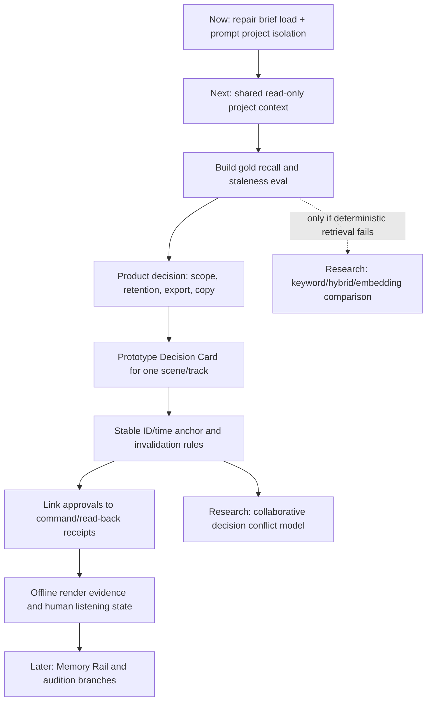

# KYX — Audit projektovej sémantickej pamäte

- **Dátum auditu:** 2026-10-28
- **Typ:** statický, dôkazmi podložený produktový a architektonický audit
- **Auditovaný commit:** `811662d1` (`main`)
- **Stav pracovného stromu:** zdieľaný strom obsahoval rozpracované zmeny iných úloh; zistenia sú porovnané s commitnutým kódom tam, kde sa dotknuté súbory menili. Audit nepripisuje tieto rozpracované zmeny tejto úlohe.
- **Zmeny produkčného kódu:** žiadne
- **Spustené testy/render/listening:** žiadne. Názvy existujúcich testov sú uvedené ako dôkaz pokrytia v repozitári, nie ako tvrdenie o ich vykonaní v tomto audite.

## Executive assessment

KYX už má dobré základy pre tvorivú kontinuitu: projektový model je autoritatívny, Producer Brief je malý, štruktúrovaný, používateľom uložený a undoovateľný; AI kandidáti majú samostatnú lokálnu líniovú históriu; reakcie na návrhy sú oddelené od výstupu modelu; MCP má rizikové triedy, checkpointy, auditný záznam a read-back. Tieto systémy treba zachovať a skladať dokopy, nie nahradiť jednou „AI pamäťou“.

**Hlavná medzera:** KYX zatiaľ nevie spoľahlivo odpovedať na otázku „čo sme sa rozhodli, prečo, pre ktorú časť skladby a či to stále platí?“ Producer Brief uchováva všeobecné projektové fakty, nie konkrétne schválené rozhodnutia. Candidate lineage uchováva návrhy aj obsah, ale neurčuje, ktorý bol schválený a prečo. Reakčný ledger sleduje niektoré výsledky bez väzby na projektové rozhodnutie. MCP read-back potvrdzuje jednotlivú operáciu, nie dlhodobý tvorivý zámer.

**Zrelosť:** operačný projektový stav je vyspelý; používateľom schválený projektový kontext má úzky **M2-like** základ; kontinuita rozhodnutí viazaná na sekciu/objekty je **M0–M1**; verifikácia zvuku je čiastočná, ale s rozhodnutiami neprepojená. Celková zrelosť pre ústredný scenár „vráť sa o tri týždne a pokračuj podľa schváleného zámeru“ je **M1**.

**Najlepší ďalší krok:** najprv opraviť ochrannú hranicu pri načítaní poškodeného Producer Briefu a sprístupniť existujúci projektový kontext cez rovnaký read-only MCP/Intent kontrakt. Potom otestovať malý, výslovne používateľom schválený „Decision Card“ pre jednu scénu a stopu. Nezačínať vektorovou databázou ani automatickým vyvodzovaním vkusu z parametrov.

## Rozsah a dôkazové označenia

Audit sleduje projektový model, príkazy/undo, ukladanie a obnovu, Producer Brief, session context, Producer DNA, reaction ledger, lineage, MCP read/write a read-back, anotácie, identitu objektov, export a spoluprácu.

- **Observed / Code-confirmed:** priamo potvrdené implementáciou alebo existujúcim kontraktom/testom.
- **Inferred:** záver z viacerých implementovaných ciest; nie samostatne overený používateľským testom.
- **Hypothesis:** vierohodná možnosť, ktorú treba experimentálne overiť.
- **Not verified:** v tomto auditnom kroku nebola cesta, runtime správanie alebo používateľský výsledok overený.

Zmenené súbory v zdieľanom pracovnom strome sa nepovažujú za stabilný release stav. MCP/performance zmeny v `src/mcp/tools.ts` a `src/mcp/agentTrust.ts` pridávajú Live Set/macro surface; nemenia však tu sledované project-memory kontrakty. Pred implementáciou odporúčania treba relevantné súbory znovu skontrolovať po dokončení súbežnej práce.

## Architektúra a autorita stavu

| Oblasť | Stav potvrdený v kóde | Autoritatívny vlastník a cesty | Užívateľ / agent / trvácnosť | Dôvera a hranica |
|---|---|---|---|---|
| Projektový stav | **Exists — Code-confirmed.** Projekt obsahuje BPM, tóninu, tracky, patterny, scény, arrangement, markery, FX, automation a ďalšie dáta. Aktuálne `SCHEMA_VERSION = 40`. | `src/project-model/types.ts:1455` (`ProjectDocument`), `src/project-model/schema.ts:70`; všetky bežné úpravy prechádzajú cez command/store. | Používateľ: áno. MCP: čítanie a povolené zmeny. Persistuje sa cez IndexedDB, export/share a podľa zapnutého collab aj Y.Doc. | Zdroj pravdy je projektový dokument; názov tracku nie je identita. |
| Príkazy a undo/redo | **Exists — Code-confirmed.** `snapshot()` tvorí deltu s execute/undo; store má LIFO undo/redo a revíziu. Undo história je session-only a pri `replaceDoc()` sa čistí. | `src/commands/core.ts:34-70`; `src/store/ProjectStore.ts:74-92, 127, 295-299, 326-420, 543-681`. | Používateľ aj MCP; zmeny sú reverzibilné v otvorenej session. MCP checkpoint obnoví projekt ako jednu undo zmenu. | Command label a delta opisujú čo sa zmenilo, nie prečo to umelec chcel. Revízia store nie je trvalou revíziou v `ProjectDocument`. |
| Save, recovery, snapshots | **Exists — Code-confirmed**, s oddelenými hranicami. Projekt sa zapisuje atomicky spolu s ukazovateľom „recent“. Autosave/recovery a snapshots sú samostatné systémy. | `src/persistence/ProjectRepository.ts:62-93`; `src/persistence/save-lifecycle.ts`; `src/persistence/recoveryBuffer.ts`; `src/persistence/SnapshotRepository.ts`. | Lokálne. Snapshots držia celé projektové dokumenty, max. 20 na projekt. Recovery buffer je projektovo kľúčovaný; obnovenie validuje dokument, ID projektu a migráciu. | Obnovenie projektu je nezávislé od AI/modelu. Mazanie primárneho projektu nekaskáduje zjavne do všetkých sekundárnych úložísk — SM-11. |
| Projektový Producer Brief | **Exists — Code-confirmed, úzky rozsah.** Verzované fakty: genre/style/mood, BPM rozsah, key, dĺžka, role, energia/density/complexity/variation, preserve/prohibition. Zdroj/confidence sa rozlišuje. | `src/project-model/types.ts:1383-1420`; `src/project-model/producer-brief.ts:130`; `src/commands/producerBriefCommands.ts:7-36`; `src/intent/brief-contract.ts:177`; UI v `src/ui/IntentPanel.tsx`. | Používateľ ho môže uložiť, zapnúť/vypnúť, odobrať fakt alebo vymazať; zmena je súčasť projektu a undo. Export/share kopíruje dokument; Y.Doc synchronizuje pole. | Raw prompt, audio a lyrics sa do briefu neukladajú. Brief nie je poznámka k refrénu ani rozhodnutie s dôvodom. |
| Session context a prompt history | **Exists — session-only.** Posledná generácia kandidátov je referencovateľná; posledných 24 promptov je v pamäti modulu. | `src/intent/session-context.ts:17-64`; používanie v `src/ui/IntentPanel.tsx:1299-1327, 1426-1434, 5579-5596`. `src/intent/producer-session.ts` ukladá session rozhodnutia v module. | Viditeľné prompt chips; reload ich odstráni. Posledný kandidát sa pred aplikovaním kontroluje na `docId`; prompt history nemá project ID. | Správne krátkodobé, ale nie projektová pamäť. Session „decision“ po generovaní nie je potvrdenie, že používateľ vybral výsledný zvuk. |
| Producer DNA / osobné preferencie | **Exists — oddelený lokálny profil.** Štruktúrované porovnania, opravy intentu, workflow udalosti, favorite/style príklady a evaluácia; bez raw promptov/názvov projektov v hlavnom event kontrakte. | `src/intent/producer-memory-core.ts`; `src/intent/preference-ledger.ts`; `src/persistence/ProducerMemoryRepository.ts`; `src/intent/producer-memory-management.ts`; UI `src/ui/ProducerDnaCompare.tsx`. | Lokálny IndexedDB/localStorage; export/import je používateľská akcia; learning toggle a reset existujú. Nie je to súčasť exportu jedného projektu. | Má slúžiť ako opt-in naprieč projektmi, nie ako pamäť konkrétneho refrénu. Profil a projektové rozhodnutia nesmú splývať. |
| Producer lineage | **Exists — partial continuity.** Uchová kandidátsky pattern, normalizovaný intent, content hash, parent/root hash, candidate index a project fingerprint. | `src/intent/producer-lineage-core.ts:41-64, 292-419`; `src/persistence/ProducerLineageRepository.ts`; `src/ui/IntentPanel.tsx:1246-1267, 1299-1311`. | Lokálna IndexedDB; UI ponúka pokračovanie vetvy a zabudnutie vetvy; Producer DNA pack ju môže explicitne exportovať/importovať. | Je to história kandidátov, nie autoritatívny záznam rozhodnutia alebo dôvodu. Fingerprint sa mení pri zmene track topology/order — SM-05. |
| Action / undo history | **Partial — Code-confirmed.** Store drží command type/label a obmedzený zoznam histórie. MCP `kyx_state history` a `kyx://project/history` čítajú posledné undo labely. | `src/store/ProjectStore.ts:168-235`; `src/mcp/tools.ts` (`kyx_state`, `stateSnapshot`, `readMcpResource`). | Čitateľné v UI/MCP; session-only; capy 20/64 v rôznych častiach. | Záznam zmeny nie je záznamom motivácie, súhlasu ani toho, či zvuk fungoval. |
| Reaction ledger | **Exists — partial, pravdepodobnostný signál.** Zaznamená outcome návrhu z undo/transport/edit udalostí a používa ho na obmedzené zoradenie už existujúcich Intent možností. | `src/intent/reaction-ledger.ts`; `src/intent/reaction-learning.ts`; `src/intent/reaction-choice-bias.ts`; storage `src/persistence/ReactionRepository.ts`; wiring `src/services.ts:566-618`. | Lokálny IndexedDB ledger, max. 256; kill switch `pf:reaction-ledger`; po hydrate pôsobí ako profil, nie ako projektový záznam. | Transport move alebo 90 sekúnd bez undo sa interpretuje ako „kept“. To je užitočný behaviorálny signál, nie explicitné schválenie — SM-06. |
| MCP audit a checkpointy | **Exists — operations/recovery, nie sémantická pamäť.** Audit log do 200 položiek; checkpointy sú plné kópie dokumentu, per project+name, v samostatnej IndexedDB. | `src/mcp/agentTrust.ts:238-481`; `src/mcp/attribution.ts`; `src/mcp/tools.ts:8718-9046`; `src/persistence/McpCheckpointRepository.ts`. | Agent activity/audit je lokálny; checkpointy prežijú reload, ak IDB funguje; restore je jedna undoable zmena. | Audit sumarizuje volanie, checkpoint zachová stav, ale ani jedno neuchováva schválený hudobný dôvod a cieľ. |
| Anotácie a sekcie | **Partial — Code-confirmed.** Scény majú name/role, markery majú name/type/tick a môžu byť spojené s clip ID. | `src/project-model/types.ts:768-844`; `src/commands/markers.ts`; arrangement/scenes commands. | Používateľ môže pomenovať sekcie/markery; MCP vie čítať scény a markery. | Nejde o anotácie s autorom, pôvodom, stavom súhlasu, cieľovými obmedzeniami alebo dôvodom. |
| Sémantické rozhodnutia projektu | **Missing as a first-class contract.** V kóde sa nenašiel model prepájajúci schválený zámer, dôvod, scope, source, stav, revision/anchor a výsledok. | Najbližšie sú Brief, lineage, reaction log, undo, MCP receipt a render metrics — zatiaľ oddelené. | Používateľ nemá zoznam rozhodnutí s možnosťou supersede/stale; MCP nemá takýto read endpoint. | Hlavná medzera auditu. |
| AI embeddingy | **Exists, ale pre iný účel.** Text a profil/audio referencia sa menia na conditioning vektory pre generovanie/ranking. | `src/intent/semantic-conditioning.ts`; `src/ai/semantic/semantic-client.ts`; `src/ai/semantic/semantic-worker.ts`. | Voliteľný lokálny model/worker, fallback existuje. | Nie je to index rozhodnutí ani projektový retrieval. Použitie embeddingov na pamäť nie je podložené požiadavkou ani evalom — SM-14. |
| Realtime hranica | **Code-confirmed architektonicky.** V kontrolovaných `src/audio-engine/`, `src/audio-worklets/`, `src/scheduler/` a `src/transport/` sa nenašla priama závislosť na Producer Brief/ProducerMemory úložisku. | UI/Intent → command/store → projekt; Worklet ostáva DSP vykonávacou hranicou. | Žiadny nový AI/DB/network krok sa nemá pridať do realtime callbacku. | V tomto audite nebola meraná audio latencia ani prehrávanie. |

### Maturita pamäťových dimenzií

Stupnica je použitá na každú dimenziu zvlášť; M2 pri Producer Brief znamená iba štruktúrovaný projektový kontext, nie hotovú sémantickú decision graph.

| Dimenzia | Maturity | Dôvod |
|---|---:|---|
| Operational project state | **M3** | Bohatý persistentný model, stabilné IDs, schema migration, save/export/collab; je to stav projektu, nie vysvetlenie jeho významu. |
| Action / event history | **M1** | Undo labels, reaction/audit events, lineage a snapshots; chýba spoločný účel/provenance stream a undo sa neobnoví po reopen. |
| Session context | **M2** | Kandidáti, follow-upy a prompt strip fungujú v rámci session; nie sú dlhodobé a niektoré sú project-agnostic. |
| Musical annotations | **M1** | Scene role/name a typed markers existujú; nemajú status, zdroj a rozhodovací vzťah. |
| Semantic decisions | **M0** | Nie je prvotriedny model schváleného hudobného rozhodnutia so scope, dôvodom a stale životným cyklom. |
| Verification / outcomes | **M1** | Niektoré MCP receipts a offline metrics existujú, ale nie sú naviazané na dlhodobý zámer; listening approval nie je samostatná udalosť. |
| Cross-session continuity | **M2** | Project Brief, lineage a checkpoints prežijú reload, ale odpovedajú na rôzne otázky a nemajú spoločné rozhodovacie retrieval. |
| User-level preferences | **M3 (narrow)** | Lokálny Producer DNA má bounded event/data contracts, opt-out, export/reset; ide o osobný profil, nie projektovú pamäť. |
| Retrieval quality | **M1** | Structured project/lineage lookups existujú; nie je eval presnosti/staleness pre otázky na rozhodnutia. |

## Profesionálne workflow: hranice a príležitosť

| Workflow | Čo už funguje | Zbytočná hranica | Čo by sa zlepšilo |
|---|---|---|---|
| Create/import/record → edit → mix → save/reopen → export | ProjectDocument, command/undo, project save, recovery, snapshots, export/share sú samostatné a lokálne použiteľné cesty. | Projekt po reopen obnoví hodnoty a brief, nie zdôvodnenie konkrétnej mix voľby. | Decision Card sa uloží vedľa projektového stavu a exportuje spolu s ním; open zostane offline a nezávislý od modelu. |
| Iterovať vokálny chain | FX parametre a automation sú v project state, MCP má čítanie/katalóg/command/read-back, checkpoint vie vrátiť session. | Nie je ľahké vysvetliť, či sa threshold/space menil kvôli refrénu, čo malo zostať zachované a či to človek schválil. | Decision ID pred plánom, exact FX instance ID, one-undo application a read-back, potom voliteľný offline A/B. |
| Požiadať AI o sekvenciu zmien | MCP risk/permission, batch, dry run, action receipts, read-back a checkpoint už tvoria silný read→act→verify základ. | Agent nemá spoločný read-only Producer Brief context; úspech callu nie je dôkaz, že user intent sa splnil. | Najprv shared context; potom decisionId/precondition → approval → canonical commands → structured verification. |
| Porovnať tvorivé alternatívy | Candidate bank, audition, Producer Lineage, ghosts/A-B a reaction learning poskytujú alternatívy. | Candidate persistence nie je to isté ako user approval; prečo bol variant vybraný a ktorý je current truth sa rozchádza medzi systémami. | Explicitný outcome status a krátke user-authored rationale; audition zostáva projektovo read-only. |
| Obnova po prerušení/zlyhaní | Synchronous recovery buffer, project snapshots, MCP checkpoints a command undo pokrývajú viacero recovery prípadov. | Recovery obnoví dokument, nie sémantickú väzbu na intent; project delete tiež nedefinuje odstránenie všetkých kópií. | Po uloženom rozhodnutí musí recovery zachovať kartu konzistentne; destructive purge má pokryť všetky sekundárne kópie. |

### Workflow friction → schopnosť → merateľný výsledok

| Friction v dnešnom workflow | Navrhovaná schopnosť | Merateľný výsledok |
|---|---|---|
| Po prestávke používateľ nájde stav, ale nie dôvod, prečo je vokál v jednom refréne úzky. | Approved Decision Card s scene/track anchorom a krátkym dôvodom. | ≥95% správny recall na gold scénaroch; 0 rejected/stale recallov ako schválených. |
| UI Intent môže čítať brief, MCP ho nevie rovnako získať. | Shared read-only project context projection pre oba povrchy. | Field-for-field parity v test fixture; 0 mutácií pri context read. |
| Všetky generované alternatívy sa ukladajú do lineage, no status vybratej alternatívy nie je jednotný. | Explicitný generated/auditioned/approved/applied/reverted stav. | Po Use je presne jeden kandidát approved/applied; audition samo nič neschváli. |
| Track/clip zmena môže spraviť starý scope neplatným alebo lineage filter neprístupným. | Deterministický identity remap + stale resolver. | 0 tichých clone targetov; stale retrieval <1% na lifecycle suite. |
| Agent hlási úspešné volanie, ale nevie preukázať hudobný výsledok. | Decision→command→read-back→offline evidence trace. | Každý receipt rozlišuje applied, read-back a measured; nikdy nepredstiera human listening. |

## Skutočný lifecycle dnes

| Fáza | Stav | Dôkaz / limit |
|---|---|---|
| Capture | **Partial** | Intent UI parsuje brief a dovolí uložiť štruktúrované fakty. `persistLineageCandidates()` zapisuje všetkých generovaných kandidátov; `recordIntentDecisions()` sa volá po vytvorení návrhu. Chýba jednotné explicitné „toto rozhodnutie schvaľujem“. |
| Ground | **Partial** | Kandidáti majú project fingerprint a content hash; brief má len project scope. Rozhodnutie nemá súčasne track/FX/clip/scene a interval. |
| Distinguish | **Partial** | Brief rozlišuje prompt-parsed a user-confirmed. Lineage/reaction udalosti ale nemajú spoločný stav `proposed → approved → applied → verified`. |
| Persist | **Partial** | Brief žije v ProjectDocument; producer memory, lineage, reaction, snapshots a checkpointy žijú v rôznych úložiskách s rozdielnymi export/deletion pravidlami. |
| Retrieve | **Partial** | Intent UI číta brief a lineage. MCP číta štruktúru/scény/markery/history; v MCP zdrojoch a dispatcherovi sa nenašiel `producerBrief` consumer ani decision memory endpoint. |
| Apply | **Partial** | Intent a MCP používajú command boundary/undo a viacero nástrojov vracia read-back. Neexistuje väzba rozhodnutia na príkaz, ktorý ho realizoval. |
| Validate | **Partial** | Existuje session revision stale guard pri generovaní, brief konflikt gate a MCP read-back. Nie je tu stale-check konkrétneho semantic decision anchoru po reload/edite. |
| Revise | **Partial** | Brief fakt možno odobrať/aktualizovať; lineage vetvu možno zabudnúť; user-level profil resetovať. Rozhodnutia sa nedajú označiť superseded/rejected/stale ako samostatná história. |
| Delete | **Partial** | Lokálne memory reset/forget existuje. Projektové mazanie nekaskáduje viditeľne do snapshots/MCP checkpoints/recovery buffer; rozsah trvalého vymazania nie je jednotný. |
| Recover/export | **Partial** | Projektový brief cestuje v exporte/share/Y.Doc; lokálne personal-memory packs sa exportujú osobitne. Snapshots/checkpoints obsahujú celé dokumenty. Nie je jeden používateľovi vysvetlený retention/export kontrakt pre budúce decision records. |

## Identita, rozsah a invalidácia

| Operácia | Pozorovanie z príkazov/modelu | Dôsledok pre budúce rozhodnutia |
|---|---|---|
| Rename / move | In-place track/scene/clip zmeny typicky zachovávajú ID; pri cielení sa v kóde používa ID, nie meno. Arrangement/audio klipy pri move/trim/stretch menia čas/parametre a zachovajú ID. | Anchor na ID prežije premenovanie/presun, ale treba znovu vyrátať časovú platnosť. Mená používaj iba na zobrazenie. |
| Duplicate track | `duplicateTrack()` vytvára nové track-, FX- a pad-ID a remapuje automation/LFO/macro linky; žiadny spoločný semantic `origin/cloneOf` kontrakt sa nenašiel. | Rozhodnutie sa nesmie automaticky zdediť na kópiu. Ponúkni „skopírovať aj rozhodnutie?“ ako výslovný úkon. |
| Duplicate arrangement clip | `duplicateArrangementClip()` vytvára nové clip ID, obsah/scéna sa kopírujú. | Rozhodnutie naviazané na pôvodný clip sa samo nepresúva na kópiu. |
| Split scene clip | `splitArrangementClipAtTick()` necháva pôvodné ID na ľavej časti a vytvára nové ID pre pravú; clip groups sa aktualizujú. | Musí existovať politika: zdediť do oboch / len pokračovanie / označiť na potvrdenie. Zatiaľ žiadna sémantická politika. |
| Split audio clip | `splitAudioClipAtTick()` vytvára nové audio clip fragmenty s novými ID. | Časové rozhodnutie musí dostať nové anchor-y alebo sa označiť stale; nedržať len staré ID. |
| Merge | **Not verified.** V auditovaných arrangement/audio príkazoch sa nenašiel jeden všeobecný merge kontrakt. | Neplánovať remapping, kým sa nepotvrdí, ktoré merge verbá sa skutočne používajú. |
| Tempo / scene tempo | Projekt má BPM a scény môžu mať vlastný BPM. Tick pozícia a absolútny čas nie sú zamieňateľné. | Uložiť hudobnú pozíciu a anchor fingerprint; sekundový/sample rozsah pridať iba tam, kde je zdroj audio. Pri zmene tempo mapy prepočítať sekundy. |
| Plugin reorder / replace | Efektové inštancie majú FX ID; reorder mení poradie, odstránenie/nové vloženie mení cieľový zoznam. | FX decision má obsahovať trackId+fxId+canonical param id a chain fingerprint. Pri zámene inštancie sa má spýtať, nie sa spoliehať na rovnaký názov. |
| Delete | `deleteTrack()` odstraňuje/čistí niektoré známe projektové referencie v jednej undo zmene; clip delete odpojí linked markers. | Použiť to ako vzor pre semantic reference cleanup, ale decision record radšej označiť stale/tombstoned než potichu zahodiť. |
| Undo / redo | Store obnovuje dokumentový snapshot/delta a zvyšuje in-memory revision pri execute/undo/redo. História sa neobnoví po otvorení projektu. | Schválenie, aplikovaný príkaz a overenie sa nesmú zamieňať. Undo musí buď vrátiť aj stav rozhodnutia, alebo ponechať jasnú udalosť `reverted`; rozhodnutie nemažeť bokom. |
| Project copy / recovery | `ProjectRepository.duplicate()` vytvára nové project ID a kopíruje vnútorný dokument. Recovery vyžaduje zhodu project ID a migráciu. | In-document rozhodnutia prirodzene skopírujú spolu s projektom; externé decision store by vyžadovalo explicitný copy/omit/remap kontrakt. |

## 15 zistení a odporúčaní

### SM-01 — Chýba záznam rozhodnutia prepojený s výsledkom

- **Závažnosť:** High · **Dôvera:** High · **Dôkaz:** Code-confirmed · **Workflow:** pokračovanie po prestávke, mix iterácia, AI read-act-verify.
- **Pozorovanie:** `ProjectProducerBriefV1` ukladá allowlist faktov; `ProducerLineageNodeV1` ukladá intent/pattern/hash; reaction ledger ukladá outcome; MCP action receipts vracajú jednotlivý read-back. Žiadny model ich nespája cez stabilné `decisionId`.
- **Dopad a koreň:** po týždňoch možno obnoviť stav alebo vybrať kandidáta, ale nie vysvetliť „prečo sme to zvolili“ a či je rozhodnutie ešte aktuálne. Existujúce building blocks sú dobré, ale reprezentujú iné vrstvy.
- **Minimálne zlepšenie:** najskôr prototypovať jeden používateľom potvrdený Decision Card na vybranej scene/tracku; väzby na vykonanie/verifikáciu pridať až po stabilnom capture a invalidácii.
- **Riziko:** ak AI text navrhne ako fakt, vzniká falošná spomienka. Žiadny memory write z audio callbacku; žiadne auto-apply.
- **Akceptácia:** pri 20 testovacích scenároch odpoveď uvádza zdroj, stav, scope a revíziu; 0 nesprávnych „approved“ recallov; bez schválenia sa nič neukladá.
- **Klasifikácia:** **DESIGN REVIEW**.

### SM-02 — Producer Brief je správne bezpečný, ale príliš všeobecný pre „druhý refrén“

- **Závažnosť:** High · **Dôvera:** High · **Dôkaz:** Code-confirmed · **Workflow:** song arrangement a mix.
- **Pozorovanie:** Brief obsahuje žáner, mood, BPM/key, roly a globálne preferencie/preserve/prohibition, max. 32 faktov. Nemá scene/clip/track/FX scope, dôvod, odmietnuté alternatívy ani stav superseded.
- **Dopad a koreň:** „vokál v refréne nech zostane intímny“ sa nedá vyjadriť ako lokálne rozhodnutie; uloženie do globálneho `preserve` by nesprávne rozšírilo rozsah.
- **Minimálne zlepšenie:** ponechať brief ako project-level constraints; pridať samostatný scoped Decision Card, nie nafukovať brief na archív konverzácie.
- **Riziko:** nejasný scope môže zabrániť tvorivej zmene inde v skladbe.
- **Akceptácia:** projektová constraint a section-local decision sa zobrazia oddelene; finálny refrén môže mať vlastnú výnimku bez prepisu ostatných scén.
- **Klasifikácia:** **DESIGN REVIEW**.

### SM-03 — Intent UI a MCP nemajú spoločný read-only kontextový kontrakt

- **Závažnosť:** High · **Dôvera:** High · **Dôkaz:** Code-confirmed · **Workflow:** požiadať MCP/Intent o sekvenčné úpravy podľa uloženého zámeru.
- **Pozorovanie:** Intent UI volá `compileBriefContract()` s aktívnym projektovým briefom; `kyx_state` a MCP resources vystavujú overview/tracks/scenes/markers/history, nie Producer Brief. V `src/mcp` sa nenašiel brief consumer.
- **Dopad a koreň:** manuálna generácia môže rešpektovať uloženú constraint, kým agent nemá rovnakú pravdu na čítanie a môže urobiť nekompatibilný návrh.
- **Minimálne zlepšenie:** read-only `project-context` výstup z jednej shared funkcie: brief facts s pôvodom/confidence, scene role/time, track/effect stable IDs, project revision. Nech MCP a Intent volajú rovnaký resolver.
- **AI/MCP úloha:** MCP len číta a citovane vracia kontext; deterministická kontrola rozhoduje o platnosti; používateľ schvaľuje zmenu.
- **Bezpečnosť:** žiadny nový read permission pre cross-project profil; žiadna zmena projektu pri čítaní.
- **Akceptácia:** fixture s preserve/prohibition sa v UI a MCP zhoduje na poli aj pôvode; 0 neznámych faktov sa nevydáva za potvrdené.
- **Klasifikácia:** **PROTOTYPE** (najprv read-only).

### SM-04 — Uložená lineage zahŕňa návrhy, nie iba vybraté výsledky

- **Závažnosť:** Medium-High · **Dôvera:** High · **Dôkaz:** Code-confirmed · **Workflow:** porovnávanie variantov.
- **Pozorovanie:** po úspešnom generovaní `IntentPanel` volá `persistLineageCandidates()` pre celý bank, ešte pred audition/use. `SessionGeneration.appliedIndex` sa vytvorí ako `null`; prehľadané call sites ho pri apply neaktualizujú. Apply/undo sa zaznamenávajú oddelene ako hashované workflow udalosti.
- **Dopad a koreň:** lineage je vhodná na návrat ku kandidátom, ale bez spoločného statusu nevie odlíšiť „vygenerované“, „vypočuté“, „schválené“, „odmietnuté“ a „aplikované“. Zobrazenie kandidáta v lineage nie je dôkaz, že ho používateľ vybral.
- **Minimálne zlepšenie:** pred zmenou dátového kontraktu prototypovať explicitný outcome event s candidate hash a actor/action; považovať iba explicitné `USE` za approval. Timeout/transport signál ponechať ako `heard/likely-kept`, nie `approved`.
- **Akceptácia:** po čerstvom vygenerovaní sa kandidáti zobrazia ako návrhy; po audition stále nie sú schválené; po Use sa presne jeden označí applied; undo ho zmení na reverted.
- **Klasifikácia:** **PROTOTYPE**.

### SM-05 — Project fingerprint Producer Lineage sa mení pri štrukturálnej úprave trackov

- **Závažnosť:** Medium · **Dôvera:** High · **Dôkaz:** Code-confirmed · **Workflow:** návrat k predchádzajúcim variantom.
- **Pozorovanie:** `projectKeyForLineage()` hash-uje project ID a zoradený zoznam `(kind, track.id, drum pad ids)`. Intent UI načítava lineage iba pre aktuálny vypočítaný kľúč.
- **Dopad a koreň:** pridanie/odstránenie/duplikácia alebo preskupenie trackov zmení kľúč. Staré vetvy sa nestratia, ale v aktuálnom projekte prestanú byť viditeľné. Rename bez zmeny ID problém nespôsobí.
- **Minimálne zlepšenie:** oddeliť stabilnú project identity od `context fingerprint`; lineage načítať podľa project ID a pri zmene topology zobrazovať pôvodný fingerprint ako kontext, nie vetvu zahodiť.
- **Riziko:** samotný project ID nie je dosť na to, aby sa stará veta automaticky znovu použila na zmenený projekt; retrieval musí ukázať mismatch a abstain.
- **Akceptácia:** rename/move zmeny nemenia dostupnosť; add/delete/reorder tracku zachová možnosť prezrieť staré vetvy s varovaním, no nespôsobí ich tiché použitie.
- **Klasifikácia:** **FIX NOW** pre kontinuitu lineage, bez rozšírenia do semantic memory.

### SM-06 — „Kept“ v Reaction Ledger je behaviorálny odhad

- **Závažnosť:** Medium-High · **Dôvera:** High · **Dôkaz:** Code-confirmed · **Workflow:** učenie osobného štýlu a výber Intent interpretácie.
- **Pozorovanie:** ledger uzavrie návrh ako kept po 90 sekundách bez undo alebo po posune transportu; undo je priradené k presne tej položke; edit môže byť „tweaked“. Ledger má lokálne uloženie, kill switch a obmedzený dopad na triedenie existujúcich možností.
- **Dopad a koreň:** používateľ mohol nepočuť návrh alebo nechať transport plynúť bez schválenia. Dobrý behaviorálny signal nie je umelcova výslovná voľba.
- **Minimálne zlepšenie:** zachovať tieto outcome names/weight ako pravdepodobnostné preference; pri projektovej pamäti vyžadovať explicitnú voľbu `approve/reject`.
- **Riziko:** nechcené učenie globálneho profilu a prehnané tvrdenie, že rozhodnutie bolo schválené.
- **Akceptácia:** žiadny timeout/transport outcome sa neobjaví v odpovedi na „čo sme schválili?“; kill switch dá identické výsledky ako bez ledgeru.
- **Klasifikácia:** **DESIGN REVIEW** pre význam statusov; existujúci ledger nemeníť bez eval dôvodu.

### SM-07 — Session prompt history nie je viazaná na projekt

- **Závažnosť:** Medium · **Dôvera:** High · **Dôkaz:** Code-confirmed · **Workflow:** prepínanie projektov v tej istej tab/session.
- **Pozorovanie:** `session-context.ts` drží `PromptHistoryEntry {text, at}` bez `docId`; UI zobrazuje posledné prompty ako rerun chips. Posledný candidate generation sa oproti `doc.id` kontroluje, prompt chips však nie.
- **Dopad a koreň:** prompt z projektu A sa môže zobraziť a znovu spustiť v projekte B; zároveň prompt history po reload zmizne. Je to užitočná session pomôcka, nie bezpečná projektová história.
- **Minimálne zlepšenie:** prompt chips buď ohraničiť aktívnym project/session ID, alebo pri prepnutí projektu skryť. Neukladať raw prompty do durable memory bez samostatného súhlasu.
- **Akceptácia:** po prepnutí projektu A→B sa prompt z A nezobrazí v B; po reload sa história správa podľa jasne pomenovanej session policy.
- **Klasifikácia:** **FIX NOW** (malý UX/privacy guard).

### SM-08 — In-memory project revision nie je trvalá freshness identita

- **Závažnosť:** High pre budúcu decision memory · **Dôvera:** High · **Dôkaz:** Code-confirmed · **Workflow:** návrh po reload alebo po ručnej úprave.
- **Pozorovanie:** `ProjectStore.getRevision()` vracia monotónne číslo v inštancii store; po `replaceDoc()` história/revízia sa inicializuje podľa runtime lifecycle, nie podľa revision uloženého v dokumente. Undo/redo tiež revision zvýši. ProjectDocument nemá všeobecný persistent content revision.
- **Dopad a koreň:** číslo session 42 nemá samo osebe zmysel po reopen alebo na druhom zariadení. Použiť ho samo na stale/valid check by spôsobilo falošnú platnosť alebo falošnú nezhodu.
- **Minimálne zlepšenie:** runtime revision použiť ako krátkodobý precondition pri návrhu; dlhodobú platnosť ukotviť v identity+content hash konkrétneho scope a prípadne stabilnej schema/tempo-map verzii.
- **Akceptácia:** uložený záznam po reopen nepovažuje rovnaké číslo revision za dôkaz nezmeneného tracku; priamy hash scope mismatch vynúti reconfirm.
- **Klasifikácia:** **DESIGN REVIEW**.

### SM-09 — Objektové identity majú in-place stabilitu, nie sémantické lineage/remapping

- **Závažnosť:** High pre object-scoped memory · **Dôvera:** High · **Dôkaz:** Code-confirmed pre track/scene clips; merge neoverený.
- **Pozorovanie:** duplicate track/clip vytvorí nové ID; arrangement split zachová pôvodné ID na ľavej časti a vygeneruje nové pre pravú; audio split vytvára fragment IDs; delete čistí viaceré projektové refs. Neexistuje spoločný origin/descendant link pre významové rozhodnutia.
- **Dopad a koreň:** Decision Card naviazaná na staré ID môže po split/duplicate zostať bez cieľa alebo sa nesprávne preniesť. Track/FX ID je lepší než meno, ale nevyrieši obsahovú kontinuitu.
- **Minimálne zlepšenie:** decision anchors nech uchovávajú `targetIds`, typ operácie a scope hash; príkazy pri split/duplicate vrátia explicitný mapping starých→nových IDs. Neprenášať approval automaticky.
- **Akceptácia:** každá identity mutácia buď zachová referenciu s dôkazom, navrhne explicitný remap, alebo označí decision stale; nikdy sa netargetuje clone len podľa rovnakého názvu.
- **Klasifikácia:** **DESIGN REVIEW**.

### SM-10 — Read-back a audio metriky zatiaľ nekončia v jednej provenance stope

- **Závažnosť:** High pre AI-first dôveru · **Dôvera:** High · **Dôkaz:** Code-confirmed pre samostatné cesty; prepojenie chýba.
- **Pozorovanie:** MCP mutation receipts/readback v `src/mcp/verified-mutation.ts` a `src/mcp/intent-readback.ts` opisujú vykonanie; `src/mcp/render-summary.ts` vracia merané výsledky. Nič z toho neobsahuje stabilnú väzbu na schválený semantic decision record, ktorý v modeli chýba.
- **Dopad a koreň:** „príkaz sa vykonal“ sa môže zameniť za „zámer sa splnil“ alebo „mix znie lepšie“. Render metriky nie sú umelecký súhlas.
- **Minimálne zlepšenie:** pri budúcom schválenom Decision Card pridať oddelené `executionReceipt` (command/result/revision/hash) a `audioEvidence` (render config/metrics/hash); `listeningConfirmed` môže nastaviť iba človek.
- **Akceptácia:** MCP hlási odlišne `planned/applied/read-back/rendered/listened`; nevydá „úspešné rozhodnutie“ len preto, že command vrátil applied.
- **Klasifikácia:** **PROTOTYPE** po SM-01 a SM-03.

### SM-11 — Mazanie projektu nepreukazuje odstránenie sekundárnych plných kópií

- **Závažnosť:** High privacy/recovery policy · **Dôvera:** High · **Dôkaz:** Code-confirmed pre priame delete cesty; používateľský retention zámer treba potvrdiť.
- **Pozorovanie:** `ProjectBrowser.remove()` volá `core.repo.delete(id)`. `ProjectRepository.delete()` odstraňuje hlavný project row; snapshots majú vlastný store a `McpCheckpointRepository` vlastnú DB s plnými `ProjectDocument` kópiami. Delete handler nevolá purge snapshots/checkpoints/recovery. Snapshots sa prune-ujú na 20; MCP checkpointy sa odstraňujú po mene/eviction.
- **Dopad a koreň:** používateľ môže očakávať úplné zmazanie, hoci zálohové alebo agent checkpoint kópie prežijú. Pre sémantickú pamäť by to znamenalo, že „forget project“ nie je pravdivé.
- **Minimálne zlepšenie:** pred novou memory vrstvou zadefinovať „odstrániť z knižnice“ vs. „vymazať lokálne všetky kópie“; implementovať jeden purge orchestrator pokrývajúci project, snapshots/index, MCP checkpoints a recovery buffer.
- **Riziko:** plné purge je nevratné; UI musí mať jasný scope. Žiadne tiché mazanie existujúcej recovery zálohy.
- **Akceptácia:** po „delete all local copies“ sa ID projektu nenájde v žiadnom úložisku/indexe; test zahŕňa hlavný dokument, snapshot, checkpoint aj recovery buffer.
- **Klasifikácia:** **DESIGN REVIEW** (najprv rozhodnúť retention policy).

### SM-12 — Chybný Producer Brief môže zneprístupniť celý projekt

- **Závažnosť:** High — integrita projektu · **Dôvera:** High · **Dôkaz:** Code-confirmed, tiež uvedené ako potvrdené D-6 v `docs/CROSS-COMPONENT-CONTRACT-AUDIT-2026-10-23.md:536`.
- **Pozorovanie:** `ProjectRepository.load()` volá `validateProjectShape(result)` pred `migrateProject(result)`. Validator odmieta neplatný `producerBrief`; normalizátor v `schema.ts:2605-2618` pritom vie odstrániť neplatné brief pole. YDoc read strana preberá `producerBrief` ako unchecked cast (`src/collab/YDocAdapter.ts:115-116`).
- **Dopad a koreň:** poškodené nepodstatné metadata môžu spraviť celý projekt „not found“, hoci normalizácia vie pole bezpečne vyhodiť.
- **Minimálne zlepšenie:** bezpečný load path má sanitizovať/normalizovať optional brief pred odmietnutím projektu, zatiaľ čo naďalej prísne odmieta chybnú core project shape a future schema. Pridať repository regression pre poškodené brief + validný zvyšok projektu.
- **Riziko:** nesmie sa zmäkčiť ochrana pred future schema alebo poškodeným audio/project payloadom. Pôvodné dáta treba zálohovať/diagnostikovať pred automatickým dropom.
- **Akceptácia:** projekt s validným core a neplatným briefom sa otvorí bez briefu; neplatný core ani future schema sa stále odmietnu a zostanú viditeľné v knižnici.
- **Klasifikácia:** **FIX NOW**. V tomto kroku neimplementované, lebo zadanie bolo audit a príslušné regression testy sa nespúšťali.

### SM-13 — MCP audit summary môže uchovať úvod voľného string argumentu

- **Závažnosť:** Medium privacy · **Dôvera:** High · **Dôkaz:** Code-confirmed · **Workflow:** MCP agent calls a lokálna audit história.
- **Pozorovanie:** `summarizeToolArgs()` v `src/mcp/agentTrust.ts:361-383` uloží každý string argument v skrátenej forme (do 48 znakov), celý summary má limit 220 znakov a `completeAgentCall()` ho zapisuje do localStorage. To je bezpečnejšie než celý payload, ale nie všetky stringy sú identifikátory; voľný text môže byť citlivý.
- **Dopad a koreň:** log môže zachovať časť user instruction/label. Audit log je lokálny a obmedzený, ale nie je bez obsahu.
- **Minimálne zlepšenie:** redakcia podľa tool/schema field allowlistu; free-text fields ukladať len ako `[text: N chars]` alebo hash/typ; identifikátory a enumy možno ponechať.
- **Akceptácia:** vložiť unikátny tajný test string do voľného textového poľa, vykonať MCP call a potvrdiť, že sa v audit storage nenachádza; tool, risk, status a duration zostanú.
- **Klasifikácia:** **FIX NOW** ak sú voľné textové nástroje v produkčnom MCP; inak **DESIGN REVIEW** pri rozširovaní toolov.

### SM-14 — „Semantic embeddings“ sú conditioning pre generovanie, nie pamäť rozhodnutí

- **Závažnosť:** Medium strategické · **Dôvera:** High · **Dôkaz:** Code-confirmed · **Workflow:** návrh budúceho retrieval systému.
- **Pozorovanie:** `semantic-conditioning.ts` embeduje aktuálny text/profil/audio referenciu pre v2 priors a rankovanie; worker spracúva textové batch-e. Neudržiava index schválených rozhodnutí ani project-scoped query store.
- **Dopad a koreň:** názov „semantic“ môže viesť k predpokladu, že už existuje sémantické vyhľadávanie v histórii. Nie je to tak.
- **Minimálne zlepšenie:** najprv otestovať deterministický query nad structured records (project ID, status, target ID, time range, tags). Embeddings zvažovať len ak retrieval eval preukáže chyby, ktoré štruktúra/keyword query nerieši.
- **Riziko:** modelová podobnosť môže vytiahnuť podobnú, ale odmietnutú alebo zastaranú voľbu.
- **Akceptácia:** žiadny embedding/vector index nie je prerequisite pre project open, transport, recording ani decision lookup.
- **Klasifikácia:** **DEFER** vector retrieval; zachovať existujúci conditioning pipeline.

### SM-15 — Chýba end-to-end eval presnosti a stale recall

- **Závažnosť:** High pred rozšírením · **Dôvera:** High · **Dôkaz:** Observed v zistených test suite names, not verified runtime.
- **Pozorovanie:** existujú cielené testy `tests/producer-brief-project.test.ts`, `tests/brief-contract.test.ts`, `tests/collab-ydoc-drift.test.ts`, reaction/lineage testy a MCP audit testy. V audite sa nenašiel suite, ktorý by meral „po prestávke správne rozhodnutie, správna scéna, správny stav, abstain pri konflikte, nula cross-project leak“. Tieto komponentové testy sa v tomto audite nespúšťali.
- **Dopad a koreň:** syntaktická a persistence správnosť nepreukazuje, že model odpovedá správne na muzikantskú otázku.
- **Minimálne zlepšenie:** vytvoriť malé syntetické gold set s approved/rejected/stale/ambiguous rozhodnutiami pred implementáciou väčšieho retrieval systému.
- **Akceptácia:** explicitné metriky a threshold v sekcii experimentov; false approved recall = 0 v gated eval; stale recall <1% a cross-project recall = 0.
- **Klasifikácia:** **PROTOTYPE**.

## Prioritizované príležitosti

### Transparentná hodnotiaca škála

Skóre sú hrubé ordinal hodnoty, nie merania: **1 = nízke**, **3 = stredné**, **5 = vysoké**. Pri musician value, ecosystem leverage, architecture fit, differentiation a maintainability je vyššie lepšie. Pri reliability risk, implementation cost a validation difficulty je vyššie horšie. Poradie najprv rešpektuje bezpečnostné/integritné brány; potom hodnotu pre hudobníka, leverage a fit; pri remíze uprednostní menšiu cenu a jednoduchšie overenie. Čísla majú zdôvodnenie v každom riadku, nie sú presným produktovým ROI.

| Rank | Príležitosť | Dôkazy / confidence | Musician value | Leverage | Fit | Reliability risk | Cost | Validation difficulty | Differentiation | Maintainability | Zložitosť |
|---:|---|---|---:|---:|---:|---:|---:|---:|---:|---:|---|
| 1 | Oprava load guard pre poškodený optional brief (SM-12) | Code-confirmed | 5 | 4 | 5 | 2 | 1 | 1 | 1 | 4 | S |
| 2 | Zdieľaný read-only brief/context pre Intent a MCP (SM-03) | Code-confirmed gap | 5 | 5 | 4 | 2 | 2 | 2 | 3 | 4 | S–M |
| 3 | Project switch isolation pre session prompt chips (SM-07) | Code-confirmed | 3 | 2 | 5 | 1 | 1 | 1 | 1 | 5 | S |
| 4 | Explicit candidate status: generated/auditioned/applied/reverted (SM-04) | Code-confirmed gap | 4 | 4 | 4 | 2 | 2 | 2 | 3 | 4 | M |
| 5 | Scope hash + stale policy pre objekty/time ranges (SM-08/09) | Code-confirmed prerequisite | 5 | 5 | 3 | 4 | 4 | 4 | 4 | 3 | L |
| 6 | Decision Card proof pre jednu scene/track (SM-01/02) | Inferred opportunity | 5 | 5 | 3 | 4 | 4 | 4 | 5 | 3 | M–L |
| 7 | Purge policy pre project/snapshot/checkpoint/recovery (SM-11) | Code-confirmed gap; policy unknown | 4 | 3 | 3 | 4 | 3 | 3 | 2 | 4 | M |
| 8 | Link decision → command receipt → read-back (SM-10) | Existing receipts confirmed | 5 | 5 | 3 | 4 | 4 | 4 | 4 | 3 | L |
| 9 | UI „context being used“ panel pre Brief/section facts | Existing data; UX inferred | 4 | 4 | 4 | 2 | 2 | 3 | 3 | 4 | M |
| 10 | Minimal approved/rejected/stale retrieval eval (SM-15) | Coverage gap observed | 5 | 5 | 5 | 1 | 2 | 2 | 4 | 5 | S–M |

### H1 — vysoká hodnota, malá architektonická zmena

#### H1.1 Opraviť bezpečné načítanie poškodeného Producer Briefu

- **Používateľský problém:** jedno poškodené optional AI metadata pole nemá skryť celý projekt.
- **Dôkazy/reusable:** `sanitizeProjectProducerBrief`, normalizačný pass a repository load path už existujú; SM-12 je code-confirmed.
- **Navrhovaný tok a autorita:** IndexedDB record → bezpečne skontrolovať core project shape/schema → očistiť optional brief → vrátiť canonical ProjectDocument. Pravda ostáva ProjectDocument.
- **AI/MCP:** nepotrebné. Žiadny model ani agent nemá byť v load path.
- **Undo/persistence/observability:** oprava normalizácie nemení validný projekt; pri drop briefu vrátiť diagnostický warning do Project Browser/diagnostics, nie tichý úspech.
- **RT/performance/fallback:** žiadny audio-thread zásah; práca je limitovaná jedným malým briefom (max. 32 faktov); pri invalidnom core dokumente zachovať odmietnutie.
- **Overenie:** repository test malformed brief + good core, malformed core odmietnutý, future schema odmietnutá. Human listening netreba.
- **Kompatibilita/zložitosť:** bez schema bumpu; S. **Hodnota 5:** priamo chráni otvorenie projektu. **Novosť 1:** reliability fix, nie konkurenčný feature.

#### H1.2 Zdieľaný read-only projektový context pre Intent a MCP

- **Používateľský problém:** agent často potrebuje vedieť, čo už project brief hovorí, pred návrhom zmeny.
- **Dôkazy/reusable:** Brief contract a MCP `kyx_state` existujú oddelene; SC-03 je code-confirmed.
- **Interakcia/dataflow:** `ProjectDocument` → jeden deterministic resolver → UI confirmation summary + MCP read-only structured output s pôvodom/confidence, source path a project revision/hash. Nie je to nový state owner.
- **AI/MCP:** MCP číta; model môže vysvetliť citované fakty. Deterministická vrstva vyhodnotí conflict. Žiadny AI call nie je potrebný pre samotný lookup.
- **Atomickosť/undo/persistence:** čisté čítanie; nič sa nemení a nič sa neukladá navyše.
- **Permissions/observability:** existujúci read risk; v receipt vystaviť scope a `unknown` hodnoty bez hádania. Nepridávať implicitný prístup k Producer DNA/global preference store.
- **RT/performance/fallback:** lookup pred action; žiadne DB read z workletu. Keď brief chýba alebo invalid, vrátiť `none/unavailable`, nie odhad. Cieľ: p95 <5 ms pre deterministic local projection; žiadny network.
- **Overenie:** rovnaká fixture v UI a MCP; project switch izolácia; unknown neutrálne; request pri offline/bez modelu stále funguje. UX test s reálnym DAW používateľom.
- **Kompatibilita/zložitosť:** bez schema zmeny; S–M. **Hodnota 5:** znižuje chybné AI zmeny. **Novosť 3:** dôveryhodný agent context, nie nový model.

#### H1.3 Odfiltrovať prompt history pri prepnutí projektu

- **Používateľský problém:** prompt z inej skladby sa môže ukázať ako rerun návrh.
- **Dôkazy/reusable:** prompt history je module-level, bez docId; `lastGeneration` už docId kontroluje.
- **Interakcia/dataflow:** pri project switch skryť staré prompt chips alebo ich držať v samostatnom per-project session cache bez persistencie.
- **AI/MCP:** AI netreba; prompt rerun zostáva explicitný používateľský úkon.
- **Undo/persistence:** žiadna projektová zmena; pri cache držať len in-memory session state.
- **Bezpečnosť/RT/fallback:** raw text ostáva mimo durable memory; bez audio thread dopadu. Pri chybe context identifikácie chips skryť.
- **Overenie:** A→B prepnutie; prompt sa neobjaví ani nespustí v B; reload vyčistí history.
- **Zložitosť:** S. **Hodnota 3:** menší privacy/UX problém. **Novosť 1:** guardrail.

#### H1.4 Vytvoriť gold eval pred retrieval feature

- **Používateľský problém:** správny recall je podmienka dôvery v „pamätá si“, nie vedľajšia metrika.
- **Dôkazy/reusable:** component tests brief/lineage/reactions existujú, end-to-end semantic recall eval sa v audite nenašiel.
- **Tok:** syntetické projekty a rozhodnutia → deterministic retrieval → answer s citation/status/staleness → automated scorecard.
- **AI/MCP:** najprv baseline s deterministic query; LLM iba v oddelenom shadow experimente po golden baseline.
- **Atomickosť/RT/persistence:** read-only eval; nemá meniť project; mimo audio path.
- **Overenie:** metriky a dataset v experiment sekcii; graceful fallback = abstain.
- **Zložitosť:** S–M. **Hodnota 5:** chráni všetky budúce AI návrhy. **Novosť 4:** merateľný memory quality gate.

### H2 — koordinácia viacerých existujúcich systémov

#### H2.1 Project Decision Card

- **Používateľský problém:** uložiť „prečo“ a scope jedného tvorivého rozhodnutia bez transcript archívu.
- **Dôkazy/reusable:** ProjectDocument, scenes/markers, stable IDs, brief provenance, commands/undo, project export/collab.
- **Chýba:** first-class model statusu, source, revision/anchor, edit/remap politika, čitateľný editor.
- **Interakcia/dataflow:** používateľ vyberie scene/track/čas → napíše alebo opraví krátku vetu a constraints → explicitne `Approve` → jeden command uloží Decision Card do projektovej pravdy. AI môže navrhnúť formuláciu, ale `origin=ai-proposed`; len klik zmení status na approved.
- **Autorita:** ProjectDocument. Neukladať paralelný authoritative memory DB.
- **AI/Intent/MCP:** AI prehľadáva iba schválené/platné karty s citáciou; deterministic resolver priradí karty podľa projectId+scope+anchor. MCP read-only prvá fáza; write až cez existujúci confirmation+command contract.
- **Undo/partial failure:** schválenie/úprava karty je jeden undoable command; zlyhaný audio render nevytvára `verified`; odobranie/undo zachováva väzby predvídateľne.
- **RT/persistence/observability:** JSON record sa číta/ukladá len mimo audio thread; explicitná schema migrácia, size cap a redaction policy; UI ukazuje source, status, created/updated, stale reason.
- **Permissions/fallback:** žiadne silent capture ani auto-write. Bez karty funguje DAW rovnako; bez memory lookup AI musí oznámiť „nenašiel som potvrdené rozhodnutie“.
- **Testy/UX/perf:** JSON roundtrip, undo/redo, export/import, copy semantics, collab; 500 kariet p95 lookup <5 ms; UX štúdia či card action neprerušuje nahrávanie.
- **Riziká/kompatibilita:** schema bump a collab delta; explicitný compatibility/migration contract. **Zložitosť M–L. Hodnota 5:** kontinuita zámeru. **Novosť 5:** projektová, citovateľná tvorivá pamäť.

#### H2.2 Deterministické scope anchors a stale/reconfirm resolver

- **Používateľský problém:** stará veta o vokále nesmie prežiť bez kontroly po zmazaní, rozdelení alebo prepise klipu.
- **Dôkazy/reusable:** scene/track/clip/effect IDs, project revision, project content hashes a príkazové cleanup referencií už existujú po častiach.
- **Interakcia/dataflow:** k Decision Card uložiť type+target IDs+musical ticks+content fingerprint. Po mutation sa resolver rozhodne: `valid`, `stale`, `ambiguous`, `missing`; len valid sa ponúkne ako context.
- **AI/MCP:** AI nevyrába identity mapping; command layer vráti split/duplicate map. MCP pred aplikáciou odošle `needs_confirmation` pri stale/ambiguous.
- **Undo/atomicita:** mapping a zmena sú v tom istom command; pri partial failure nemeníť approval. Undo obnoví pre-change anchor graph.
- **RT/persistence:** deterministic post-command práce, mimo RT; bez embeddings/network.
- **Overenie:** rename/move/split/duplicate/delete/tempo/plugin reorder + undo/redo; 0 silent re-target clone; stale recall <1% na fixture.
- **Kompatibilita/zložitosť:** príkazové API rozšírenie, možné migration mapy; L. **Hodnota 5:** bezpečne umožní object-aware pamäť. **Novosť 4:** hudobná sémantika s kontrolou identity.

#### H2.3 Decision → command → read-back provenance

- **Používateľský problém:** zistiť, či AI splnila zámer alebo iba úspešne spustila príkaz.
- **Dôkazy/reusable:** MCP readback, operation risk, command history label, current revision, offline render summary.
- **Interakcia/dataflow:** approved decisionId → proposed plan/precondition → human approve → command result → structural read-back → optional offline render metrics. Statusy sú samostatné.
- **AI/MCP:** AI môže navrhnúť plan a vysvetliť namerané rozdiely; deterministic checker potvrdí target/value/revision. AI nikdy nesmie potvrdiť umelecký úspech sama.
- **Atomickosť:** zmena projektu je jedna command/undo frame. Receipt môže zlyhať alebo timeoutovať po applied; následne najprv query state, nie opakovať mutáciu.
- **RT/persistence/observability:** metrics render mimo realtime; receipt sa ukladá iba po explicitne schválenej akcii a v obmedzenom tvare.
- **Bezpečnosť/fallback:** read-only history dostupná aj bez modelu; permission lattice zostáva autorita.
- **Overenie:** stavy applied/noop/partial/error/cancel/reverted; MCP timeout/retry, stale precondition a render fault. Hudobný review porovná A/B, ale machine metrics ostanú len evidence.
- **Kompatibilita/zložitosť:** závisí od H2.1/H2.2; L. **Hodnota 5:** znižuje nedôveru a opakovanie. **Novosť 4:** uzavretá, vysvetliteľná AI pracovná stopa.

### H3 — ambiciózne, ale technicky podložené stávky

#### H3.1 Project Memory Rail / „Pokračovať v skladbe“

Zobraziť krátky, citovateľný návratový panel: potvrdené rozhodnutia, čo sa odvtedy zmenilo, stale karty vyžadujúce potvrdenie a posledné merané výsledky. Využíva H1.2 + H2.1/H2.2. AI zhrnutie je voliteľná prezentácia nad deterministickými zdrojmi; bez AI panel ukáže karty. Neobmedzuje playback ani recording. Kľúčové kritérium: 0 fabricated citations a 0 auto-mutation pri otvorení projektu. **Complexity L; Value 5, Novelty 5.**

#### H3.2 Audition branch s rozhodovacou provenienciou

Z existujúcej candidate lineage a kit/preset audition vytvoriť bezpečné A/B vetvenie, kde používateľ počuje alternatívy v aktuálnom aranžmáne, označí dôvod/voľbu a môže sa vrátiť. Projekt sa zmení iba pri explicitnom Use; výber je jedna undoable operácia. AI môže zoradiť kandidátov podľa schválených constraints, nie vyberať víťaza. Vyžaduje H2.1, H2.2 a dôkaz, že audition override nemení projekt/undo. Offline/render varianty ostávajú mimo realtime model call. **Complexity L; Value 5, Novelty 5.**

#### H3.3 Decision-aware sonic verification loop

Pre rozhodnutie typu „finálny refrén širší, bez zmeny mono-compatible low end“ vytvoriť pred/po offline render s identickým seed, effect chain a časovým scope, zobraziť stereo/mono a loudness/sub metriky. Rozhodnutie môže dostať `machine-evidence`; `listening-confirmed` nastavuje iba používateľ. Vyžaduje stabilné anchors a renderer parity; nesmie posúvať LLM ani DB do audio threadu. **Complexity L; Value 5, Novelty 5.**

#### H3.4 Collaborative decision merge s ľudským autorstvom

Pri Y.Doc kolaborácii zobrazovať autora, pôvod a konflikt dvoch rozhodnutí; nikdy automaticky nevybrať „novší“ ako pravdivý, ak si odporujú. Použiť existujúci command/collab a explicitné resolve action. Vyžaduje actor identity/trust, conflict contract a deletion/undo model; nevyrábať per-agent izolovanú undo históriu bez ADR. **Complexity L; Value 4, Novelty 5.**

#### H3.5 Kontextový plánovací agent s abstention

Agent pripraví plán z aktuálnych project facts + schválených Decision Cards + selected range; ukáže citácie a konflikty, deterministicky skontroluje plugin/track identity a až potom žiada súhlas. Ak nemá anchor alebo konflikt, povie „neviem bezpečne určiť“, namiesto voľného odhadu. Všetky writes cez canonical commands, permission lattice a jeden batch/undo frame. **Complexity L; Value 5, Novelty 4.**

#### Spoločný technický kontrakt pre H3 návrhy

- **Autorita dát:** projektové fakty a approved cards čítať z ProjectDocument; lineage/Producer DNA ostávajú pomocné, samostatné a neprepisujú projekt.
- **AI potreba:** AI sumarizuje, generuje návrh alebo hľadá formuláciu. ID resolution, stale check, permission, command apply a statusy sú deterministické. Memory lookup musí fungovať aj bez LLM.
- **Realtime a čiastočné zlyhanie:** žiadny H3 systém nevykonáva DB/network/LLM/embedding prácu v audio callbacku. Preview/render beží cez existujúcu mimo-RT/render cestu; ak zlyhá model/index/render, bežný projekt a transport pokračujú.
- **Atomickosť a undo:** každý schválený projektový write ide cez canonical command; ak jedna akcia mení zvuk a jeho status, oba zápisy patria do jedného undo frame. Render/listening evidence sa nesmie falošne rollbackovať ako parameter.
- **Persistence a scope:** project cards sú verziované a projektovo lokálne; Producer DNA sa nepridáva do project exportu. Copy/export/collab/delete majú explicitnú policy a bounded records.
- **Pozorovateľnosť a oprávnenia:** UI ukazuje zdroj, scope, stav, citations, revision/hash a dôvod stale/abstain. MCP rešpektuje existujúci permission lattice a pred mutáciou vyžaduje confirmation.
- **Testy/UX/performance:** automated identity/recovery/permission tests; p95 deterministic lookup <5 ms pri 500 kartách; žiadny network pri otvorení/recall; project-open regresia ≤1% alebo ≤20 ms. Human workflow test overí, či Memory Rail neprekáža pri editácii/nahrávaní; listening test samostatne posúdi audition/render benefit.
- **Graceful degradation/riziko:** bez semantic memory app zostáva plnohodnotný DAW; bez citačného dôkazu agent abstains. Hlavné riziko je falošný pocit istoty z AI summary, preto UI zobrazuje pôvodný záznam vedľa súhrnu.

## Top 5 odvážnych, ale dôveryhodných nápadov

1. **Project Memory Rail:** obnoví tvorivý kontext s citations a stale upozorneniami. Prerequisite: H1.2, H2.1, project-level deletion policy.
2. **Section-aware Decision Cards:** voľba/constraint k refrénu, vokálnej stope a tick rozsahu. Prerequisite: product schema, identity resolver, explicit approval UI.
3. **Audition-to-decision loop:** candidate/preset/kit počuť v aktuálnom beate, vybrať, aplikovať v jednej undo zmene. Prerequisite: verified runtime-only audition and outcome status.
4. **Verified intent execution:** decisionId → MCP plan → approval → command → exact read-back → offline render evidence. Prerequisite: stable IDs, revision/hash, permission and receipts.
5. **Collaborative decision conflict resolution:** zdieľané rozhodnutia s autorom a explicitným resolve. Prerequisite: Y.Doc contract, actor provenance, merge/undo/delete semantics.

## Minimálny navrhovaný sémantický kontrakt

Gap je dostatočne potvrdený na návrh kontraktu, nie však na implementáciu bez product approval. Toto je scaffold; prvý prototype môže byť bez migrácie a iba v testovacom fixture. Pred persistentným rolloutom treba potvrdiť schema/export/collab/delete politiku.

```ts
interface ProjectDecisionV1 {
  id: string;
  version: 1;
  // Project id is implicit: the record is owned by its ProjectDocument.
  scope: {
    type: "project" | "scene" | "track" | "clip" | "bus" | "effect";
    targetIds: string[];
    startTick?: number;
    endTick?: number;
    anchorHash?: string;
    tempoFingerprint?: string;
    sourceRange?: { clipId: string; startSeconds: number; endSeconds: number; bufferHash?: string };
  };
  statement: { text: string; source: "user" | "ai-proposed" | "imported" };
  capturedBy: { actor: "user" | "ai" | "import"; actorId?: string };
  approvedBy?: { actor: "user"; actorId?: string; approvedAt: string };
  constraints?: string[];
  decisionStatus: "proposed" | "approved" | "rejected" | "superseded" | "stale";
  capturedAt: string;
  projectRevisionAtCapture?: number; // advisory runtime precondition, never sole freshness proof
  supersedesId?: string;
  execution?: {
    status: "not-applied" | "applied" | "partial" | "failed" | "reverted";
    commandType?: string;
    appliedAt?: string;
    beforeHash?: string;
    afterHash?: string;
  };
  verification?: {
    kind: "none" | "render-metrics" | "human-listening";
    evidenceHash?: string;
    metricsVersion?: string;
    confirmedAt?: string;
  };
}
```

**Kontraktové pravidlá:** `approved` nastaví len explicitná používateľská akcia; `applied` neznamená „znie dobre“; render metrics a human listening sú rôzne evidence; `anchorHash` spolu s object IDs a hudobným tick rozsahom rozhodujú o freshness; runtime revision sama nestačí. `sourceRange` je voliteľný len pre audio clips. Text je untrusted obsah, nesmie obísť permissions. Duplicate/split nevytvára schválenie pre nový target automaticky. Ak target chýba/anchor je ambiguous, karta sa označí stale a agent abstains. Persistentná verzia patrí do ProjectDocument až po schema/migration review. Pred implementáciou stanoviť pevný počet/text cap a export/delete policy.

## Adversarial review najvyšších návrhov

| Návrh | Dá sa to urobiť dnešným workflow? Čo sa zlepší? | Veľký projekt, bypass, ID zmena, AI failure | Menší variant a rollback |
|---|---|---|---|
| Brief load guard | Používateľ môže brief vymazať ručne iba ak sa projekt otvorí; repair pred load zabráni tomu, aby malé optional metadata zablokovalo celý projekt. | Future schema a poškodené core stále odmietnuť; fallback nikdy neprepíše primárny súbor bez backup/diagnostics. | Samostatná `safeNormalizeOptionalBrief` pred odmietnutím; rollback jednoduchý, schema sa nemení. |
| Shared context read | Dnes sa brief dá prečítať v Intent UI, ale nie cez rovnaký agent read path; materiálna zmena je parita a citácie pred zásahom. | Veľké projekty vrátia len relevantné IDs/scenes/brief facts; bypassnutý FX sa stále číta ako inserted/bypassed state; bez/počas model failure zostáva deterministic read. | Začať iba brief+scenes read-only, bez memory database; odstránenie resource endpointu je jednoduché. |
| Decision Card | Dnes možno používať project brief/marker name/chat, ale žiadny z nich nemá status, dôvod a target scope naraz; Card skracuje návrat do práce a zabraňuje predstieraniu spomienky. | Po split/duplicate/deletion sa karta stane stale; veľké docs potrebujú cap; AI timeout nič neuloží; status approval je iba user action. | Prototype jednu in-memory/fixture kartu bez migrácie; deaktivácia feature flagom alebo odstránením prototype. |
| Stale anchor resolver | Dnes user môže ručne skontrolovať track/clip ID a history; resolver znižuje riziko aplikácie na zlý clone/FX. | Bypass/reorder/replace mení chain fingerprint; deleted/duplicate IDs musia vyvolať ask. Pri ambiguity žiadna mutácia. | Najprv podporiť scene+track anchors; nové typy pridávať až po identity fixture. Vypnutie znamená abstain a ručný workflow. |
| Decision→receipt→render evidence | Dnes MCP vie vrátiť hodnotu po call a samostatné render metrics; prepojenie pridáva dôkaz, ktorý sa dá znovu skontrolovať. | Large project render môže byť pomalý/cancelled; engine failure sa zaznamená ako failed, nie verified; plugin bypass je v receipt; AI call failure nemení audio. | Najprv linkovať decisionId iba k deterministic read-back; offline A/B neskôr. Každý krok je voliteľný a projekt funguje bez neho. |

## Dependencie a opatrná roadmapa



### Now (0–30 dní)

- Opraviť a otestovať malformed brief load recovery (SM-12).
- Odfiltrovať session prompt chips pri project switch (SM-07).
- Navrhnúť read-only shared context output pre brief/scenes/markers/tracks; neukladať nové dáta.
- Vyrobiť syntetický approved/rejected/stale/ambiguous gold set a baseline retrieval report.
- Rozhodnúť retention a permanent-delete semantics skôr, než pribudnú ďalšie úložiská.

### Next (30–90 dní)

- Prototypovať jednu Decision Card pre selected scene + track; explicit approval, zdroj, stav, krátke dôvody.
- Deterministicky čítať iba validné schválené karty; MCP read-only citačné rozhranie.
- Otestovať object lifecycle na rename/move/split/duplicate/delete/undo/recovery.
- Rozšíriť action receipt o rozhodnutie až po preukázaní správneho stale guardu.

### Later (90–180 dní)

- Po product approval zaviesť versioned project model/migráciu a command/UI/undo/collab/export kontrakt.
- Rozšíriť na FX, automation a audio region decisions; linking s offline render A/B metrics.
- Pridať decision-aware Memory Rail až po eval quality gate a usability testoch.

### Research horizon

- Porovnať structured lookup, scoped keyword a hybrid/embedding retrieval na rovnakom gold set-e.
- Preskúmať kolaboratívne konflikty a decision merge až po stabilnej autorite používateľských rozhodnutí.
- LLM-generated summary, personal cross-project recall a autonómne plánovanie ponechať za explicitným opt-in a oddeleným evalom.

## Experiment matrix — návrhy, nie vykonané testy

Použiť syntetické projekty s track/scene/clip IDs a umelými rozhodnutiami; nezahŕňať osobné sessions ani reálne lyrics. Každý gold record má `source`, `status`, `scope`, `captured revision/hash`, `createdAt`, a očakávanú odpoveď. Žiadny experiment nižšie nebol v tomto audite spustený.

| # | Experiment | Setup | Pass criteria |
|---:|---|---|---|
| 1 | Návrat po 3 týždňoch | 30 kariet (approved/project facts) v 6 syntetických projektoch; zmeniť `createdAt` a reload app lifecycle. Otázky typu „čo sme rozhodli o druhom refréne?“ | ≥95% správne citované odpovede; 0 fabricated facts; `source/status/scope` pri každej odpovedi. |
| 2 | Approved vs rejected | Každý projekt má podobný pár: approved „intímny vokál“, rejected „wide reverb“. | 0 rejected recallov ako schválené; `rejected` sa ukáže iba pri otázke na odmietnuté návrhy. |
| 3 | Superseded po ručnej zmene | Ručne zmeniť chain/track po approval, bez AI. | Zastarané rozhodnutie dostane `stale/reconfirm`; automaticky sa nepoužije. Stale retrieval <1%. |
| 4 | Rename/move/split/duplicate/undo | Apply každú identity operáciu na 20 fixture anchors. | Rename/move zachová referenciu; split/duplicate vyžadujú explicitné remap/reconfirm; 0 silent clone targeting; undo obnoví stav. |
| 5 | Delete target | Vymazať track, FX, clip alebo scene s kartou. | Lookup povie `missing/stale`; command apply je zablokovaný do potvrdenia; unrelated karty ostanú. |
| 6 | Poškodený brief/recovery | Zmeniť iba optional brief na invalidný payload a načítať; samostatne poškodiť core/future schema. | Valid core projekt sa otvorí s brief warning/drop; corrupt core/future schema sa bezpečne odmietne; nič sa neprepíše. |
| 7 | Project isolation | Dva projekty s rovnakými track names, podobným textom a opačnými decisions. | Cross-project recall = 0; stable IDs + project identity sú súčasť každého query. |
| 8 | Ambiguous/conflicting context | Dve approved/stale konfliktné karty, nejasný „final chorus“ marker, chýbajúci target. | Systém abstains a položí otázku; žiadna mutácia; citačný zoznam uvádza konflikt. |
| 9 | Save/index/model failure | Vypnúť IDB/model/worker v rôznych krokoch; reload a transport/record test. | Projekt sa otvorí/prehráva/nahráva bez memory; žiadna DB/network/model práca na audio thread; bez indexu „memory unavailable“, nie tichý úspech. |
| 10 | Inspect/correct/delete/export | Používateľ upraví jednu kartu, vymaže ju, exportuje projekt, skopíruje projekt a vymaže všetky lokálne kópie. | UI jasne ukáže source/status; export/copy policy dodrží; purge odstráni všetky scoped rows/snapshots/checkpoints/recovery. |
| 11 | Deterministický retrieval vs embedding | 100 syntetických otázok s synonymami EN/SK; rovnaké gold labels, tri metódy: structured, keyword, hybrid/embedding. | Porovnať precision/recall, false-approved recall, stale recall, p95 latenciu a storage. Embedding pokračuje iba ak zlepší recall bez zvýšenia false-approved. |

**Metriky:** exact decision precision/recall; `false-approved recall` (cieľ 0); stale recall (<1%); cross-project recall (0); abstention accuracy; p50/p95 lookup latency; project-open p95 regresia (≤1% alebo ≤20 ms podľa vyššej tolerancie na meranom stroji); storage/decision cap; network request count (0 pri open/recall); realtime callback work (0). Automatizované testy potvrdia dáta a stavy, nie umeleckú kvalitu. Hudobník musí samostatne potvrdiť, či audition/render pomáha v reálnom aranžmáne.

## Risk register

| Riziko | Spúšťač | Ochrana / hranica |
|---|---|---|
| Realtime audio | DB/model/network/indexing sa pridá do play/render callbacku | Všetky reads/writes/embeddings pred plánovaním alebo v worker/UI; AudioWorklet ostane len DSP. Testovať transport/record bez memory služby. |
| Project integrity | invalid optional memory field odmietne celý dokument alebo migration potichu stratí dáta | Oddeliť core schema validation od optional-field sanitization; diagnostics a backup; future schema stále odmietnuť. |
| Undo/redo | rozhodnutie sa uloží mimo command a undo vráti len audio stav | Memory decisions ukladať cez canonical command; action/evidence oddeliť ako append-only audit iba ak je to zrozumiteľné a undo semantics zdokumentované. |
| Security / prompt injection | text markeru, karty alebo transcriptu sa považuje za executable instruction | Považovať text za untrusted data; citovať; permission lattice a deterministic command validator ostávajú autorita. |
| AI agency | AI uloží vlastný návrh ako schválený alebo aplikuje stale decision | Explicit user approval; `proposed` oddelené od `approved`; stale/ambiguous = stop and ask. |
| Privacy / retention | projektové zmazanie nechá copies v backup/checkpoint/recovery/profile | Rozhodnúť delete scope; purge orchestration + test všetkých stores; local vs export policy viditeľná. |
| Compatibility | nový record rozbije export/share/Y.Doc/old clients | Versioned schema, migration/default absent, unknown fields safe policy, collab compatibility matrix; nové pole nevyžaduje model/network. |
| Retrieval correctness | podobný text vytiahne odmietnutú/stale kartu | Najprv structured filter podľa project/status/target/revision; embeddings až po eval; cite source and abstain. |
| Identity drift | split/duplicate mapne rozhodnutie na nesprávny objekt | command layer poskytne ID mapping; nikdy neodvodzovať z názvu; confirmation pri ambiguity. |
| Misleading sonic success | metriky alebo parameter delta sa prezentujú ako „znie lepšie“ | Rozlíšiť executed/read-back/rendered/measured/listened; machine evidence nie je ľudský estetický verdict. |

## Explicitne zatiaľ nestavať

- **Vector database alebo všeobecný RAG memory service:** zatiaľ neexistuje zlatý retrieval benchmark ani dôkaz, že štruktúrované lookupy nestačia.
- **Automatické vyvodzovanie trvalého vkusu z parametrov, undo alebo transportu:** current reaction/profile signals sú užitočné ako weak preference, nie potvrdené project decisions.
- **Dlhodobé ukladanie chat transcriptov, chain-of-thought, lyrics alebo audio:** nie je nutné pre požadovanú kontinuitu a zvyšuje privacy/retention riziko.
- **Automatické aplikovanie pamätaných rozhodnutí pri otvorení alebo generovaní:** stale scope a approval integrity nie sú vyriešené.
- **Jeden generický memory store ako druhý zdroj pravdy:** ProjectDocument + command/store ostáva kanonický.
- **„Sonic quality verified“ iba z metriky alebo render úspechu:** umelecké potvrdenie musí zostať oddelené a ľudské.
- **Cross-project recall projektových rozhodnutí:** Producer DNA môže byť oddelený opt-in profil; project decision nesmie uniknúť do iného projektu bez explicitného exportu/copy.

## Product-owner rozhodnutia a otvorené dôkazy

1. Má byť Decision Card ukladaná iba po explicitnom approve, alebo môže používateľ ponechať aj návrhy/odmietnutia? Odporúčanie: všetky možné, ale s jednoznačnými statusmi; len approved ovplyvňuje návrh.
2. Aký text/metadata sa prenášajú pri exporte/share/collab? Odporúčanie: project-owned cards idú s projektom, Producer DNA zostáva oddelené.
3. Pri project duplicate sa rozhodnutia kopírujú? Odporúčanie: kopírovať approved project-level notes; object-scoped decisions označiť `needs-reconfirm`, kým sa neprepočíta scope.
4. Čo znamená vymazanie projektu: skrytie z Project Browsera, alebo trvalé odstránenie vrátane snapshots/checkpoints/recovery? Dnešný kód túto garanciu nepreukazuje.
5. Kto môže rozhodnutie schváliť v collab session a ako zobrazovať konflikty/autorstvo?
6. Aký je limit počtu kariet a textu na projekt, aby project open/export/collab ostali rýchle?
7. Ktoré audio metriky sú pre jednotlivé ciele dôkazom a ktoré si vyžadujú posluch? Nepoužívať jeden univerzálny score.
8. Je „vokál intímny“ požiadavka na FX/automation, hlasitosť, priestor, aranžmán alebo iba umelecká poznámka? UI musí vedieť zobraziť neštruktúrovanú vetu bez predstierania strojovej presnosti.
9. Merge operácia audio/arrangement clipov nebola v tomto audite potvrdená; overiť reálne editorové verbá pred identity policy.
10. Nevykonané: testy, browser behavior, IndexedDB failure injection, reálny render, posluch, privacy deletion test a usability study.

## Bezpečné zmeny vykonané

Žiadne. Tento výstup je read-only auditný report. SM-12 a SM-07 sú kandidáti na malé opravy, ale implementačná brána vyžaduje relevantné regresné testy; tie sa v tomto kroku nespúšťali a používateľ zadal najprv audit. Návrhy preto uvádzajú konkrétne hranice a pass/fail kritériá bez tvrdenia o úspešnom overení.
