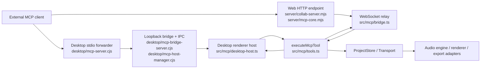

# KYX MCP control-surface audit — 2026-10-20

This is a current, evidence-bounded supplement to the historical
[`MCP_AI_CONTROL_MATRIX.md`](../MCP_AI_CONTROL_MATRIX.md). It describes what the
checked-in transports and handlers expose today; it does not turn roadmap or UI-only
features into MCP support.

## Architecture and request path

KYX has two shipping MCP transports that converge on the same renderer-side tool
executor. The stdio process and HTTP hub relay requests; neither owns project state.

**Source map.** `src/mcp/tools.ts` owns `MCP_TOOLS`, input/output contracts,
dispatch and verification read-backs. `src/mcp/bridge.ts` and
`src/mcp/desktop-host.ts` bind that executor to web and desktop services.
`server/mcp-core.mjs` implements authenticated HTTP JSON-RPC, tool/resource
discovery and the single-window relay; `desktop/mcp-server.cjs` is a stateless
stdio forwarder; `desktop/mcp-bridge-server.cjs` and
`desktop/mcp-host-manager.cjs` own the loopback/IPC boundary. The tool mutations
call command factories and the `ProjectStore`; export, audio preview, metering,
and gallery adapters are explicit host capabilities. They do not write project
state around the command layer.

The web route is disabled without `MCP_TOKEN`; the desktop bridge is opt-in and
loopback-only. Both compare bearer tokens, and the desktop bridge bounds request
size and call duration. Web relay ownership is single-window and takeover is
explicit; a displaced window cannot resolve the new owner's calls. The web
collaboration relay is a separate socket from project synchronization.

## Capability matrix

`FULL` means discoverable, validated, executed through the owning service,
read-back is returned, and relevant regression coverage exists. `PARTIAL` means
some high-value actions exist but an explicitly named operation remains absent
or transport-dependent. `NOT EXPOSED` means no MCP operation is present.

| Domain                            | UI / canonical path                                                  | MCP surface and safeguards                                                                                                                                                                                                                                          | Result                                                  |
| --------------------------------- | -------------------------------------------------------------------- | ------------------------------------------------------------------------------------------------------------------------------------------------------------------------------------------------------------------------------------------------------------------- | ------------------------------------------------------- |
| Project open/create/save/recovery | Project browser, `ProjectStore`, persistence and checkpoint services | `kyx_state`, project resources and `kyx_checkpoint` inspect or manage checkpoints; MCP binds to the already-open document. It has no project create/open/save-as/autosave/recovery command.                                                                         | **PARTIAL**                                             |
| Tracks, buses and routing         | Track/mixer UI → `src/commands/*` → `ProjectStore`                   | `kyx_tracks`, `kyx_routing`, `kyx_state`; exact IDs where supported, bounds and last-track/group checks, destructive gate/checkpoint, committed-state read-back. Some UI lifecycle operations remain absent or family-addressed.                                    | **PARTIAL**                                             |
| Arrangement clips and takes       | Arrangement/clip/take UI → command layer                             | `kyx_clips`, `kyx_arrange`, `kyx_song`, `kyx_takes`; bounded musical coordinates, stable entity IDs, one command/undo frame and read-back for supported edits. Full recording-lane editing and all audio-region operations are not exposed.                         | **PARTIAL**                                             |
| Transport and timeline            | `Transport` owns runtime musical time                                | `kyx_transport` reads and controls supported play/stop/pause/seek/loop/metronome state; musical conversion uses project meter helpers. Runtime transport is not a project undo operation. Recording arm/start/stop is intentionally unavailable through MCP.        | **PARTIAL**                                             |
| Recording                         | Recording UI and recorder lifecycle                                  | No MCP input-device selection, monitoring, arm, or start/stop recording tool. `kyx_takes` is take/comp management, not a recording controller.                                                                                                                      | **NOT EXPOSED**                                         |
| Effects and instruments           | Effect/instrument registries, command layer, AudioWorklet/runtime    | `kyx_catalog`, `kyx_fx`, `kyx_plugin_param`, `kyx_pattern`, `kyx_steps`, `kyx_notes`, `kyx_music`, `kyx_generate`; effect metadata, exact plugin-instance addressing and range validation are discoverable. Full instrument editing/audition parity is not present. | **PARTIAL**                                             |
| Automation                        | Automation UI/model → automation commands                            | `kyx_automation` reads and writes the supported track/point/parameter operations with bounded targets, command undo and state read-back.                                                                                                                            | **FULL for listed automation operations**               |
| Mixer and audio analysis          | Shared live/offline engine and rendering pipeline                    | `kyx_meter`, `kyx_loudness`, `kyx_render_summary`, `kyx_diagnose_mix`, `kyx_mix_idea`, `kyx_master`; measured results are labeled, proposals/plans distinguish preview from apply, and runtime-only work is not dry-run.                                            | **FULL for listed measurement/mix operations**          |
| History and reversibility         | `ProjectStore` undo/redo/checkpoints                                 | `kyx_undo`, `kyx_state` history, `kyx_batch`, `kyx_checkpoint`; batch writes use an undo frame, idempotent replay does not add another mutation, destructive changes checkpoint when enabled.                                                                       | **FULL for exposed history operations**                 |
| Selection and parameter context   | UI selection plus project model/registries                           | `kyx_state`, `kyx_catalog`, exact IDs and parameter metadata support deterministic targeting. There is no general MCP focused-control or selected-parameter API.                                                                                                    | **PARTIAL**                                             |
| Sharing / external effects        | Gallery/export/library services                                      | `kyx_export`, `kyx_publish_gallery`, `kyx_import_sfz` are explicit external side effects with bounded inputs and truthful result envelopes; export targets the window-owned download flow, not arbitrary paths.                                                     | **PARTIAL; packaged release path not re-verified here** |

## Ranked findings and implemented fixes

### P1 — wrong FX target and reorder contract (fixed)

`kyx_fx` had placed `instance`, `direction`, and `position` under `percent`, so
the declared MCP contract did not match the runtime operation. Exact `trackId`
operations could also fall back to a family target, and reorders could accept
fractional/out-of-range positions or create a no-op undo entry. The source tool,
both generated mirrors and regressions now pin the top-level schema, all
registered effect IDs, strict selector validation, exact-track targeting,
range checks, no-op behavior, and truthful partial-failure reporting. Commit:
`8df0e0de` (`mcp: harden FX targets and reordering`).

## Evidence and end-to-end coverage

Relevant KYX regression suites include `tests/mcp-tools.test.ts`,
`tests/mcp-idempotency.test.ts`, `tests/mcp-real-store-undo.test.ts`,
`tests/mcp-persistence.test.ts`, `tests/mcp-checkpoint-persistence.test.ts`,
`tests/mcp-edit-parity.test.ts`, `tests/mcp-mirror-sync.test.ts`,
`tests/mcp-relay-session-ownership.test.ts`, and the MCP-specific domain suites.
The source catalogue is `src/mcp/tools.ts`; its desktop and server mirrors are
generated/locked by `tests/mcp-mirror-sync.test.ts`.

For the repaired `kyx_fx` batch, verification recorded: focused MCP/desktop/
mirror tests **212/212**, `npm run typecheck` pass,
`npm run verify:mcp-mirrors` pass, changed-file Prettier pass, and the full
`npm run test:expectations` ratchet pass (**1,142 files, 12,802 passed, 129
skipped, 1 todo, 0 failed**). `node-gc -Root D:\pulse-forge` reported no
abandoned trees. Repository-wide `npm run format:check` was red on seven
unrelated dirty files; every changed file in the MCP commit passed Prettier.

Existing end-to-end tests cover command execution, state read-back, undo, and
persistence in separate stages; this audit did not run a packaged-electron
client against a real user project. Do not claim every capability row is
end-to-end verified from the unit/headless suites alone.

## Residual risks and next increments

1. Add typed output schemas to the remaining tools whose current result is
   text/structured data without a declared output contract; keep audio payloads
   and runtime-only outputs bounded.
2. Add a packaged desktop stdio smoke test covering discovery, a safe mutation,
   undo, and host shutdown. The normal app/host code is covered, but this exact
   release artifact path was not measured in this audit.
3. Keep project CRUD, recording-device lifecycle and full instrument control
   explicitly unsupported until a canonical command/service path and acceptance
   tests exist.
4. The renderer idempotency ledger is project/host scoped, not a durable
   cross-restart journal; keep retries bounded and callers responsible for
   stable unique request IDs.
