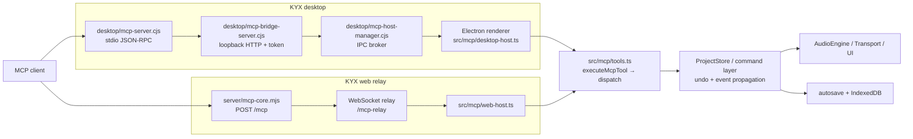

# KYX MCP Control Audit: Architecture and Findings

**Audit date:** 2026-10-20
**Scope:** KYX / Pulse Forge source tree at the audited working-tree revision. This is an evidence snapshot; the repository had unrelated dirty files during the audit.
**Method:** read-only source and test inspection before implementation changes.

## Architecture map

KYX is both an MCP server and an MCP client-like relay endpoint. The desktop server is stdio → authenticated loopback HTTP → the live Electron renderer. The web host uses an HTTP `/mcp` endpoint and a WebSocket relay to the owning browser window. Both call the same renderer executor and its 37-tool catalog. There is no production headless DAW host: the live ProjectStore, UI and AudioEngine belong to an open app window.

### Source trace

| Boundary | Evidence |
|---|---|
| Desktop transport and lifecycle | `desktop/mcp-server.cjs`; `desktop/mcp-bridge-server.cjs`; `desktop/mcp-host-manager.cjs`; `src/mcp/desktop-host.ts`. Host manager binds loopback, issues a random bearer token, and brokers calls to the renderer. Bridge limits request body/rate and uses constant-time token comparison. |
| Web transport and ownership | `server/mcp-core.mjs`; `server/collab-server.mjs`; `src/mcp/web-host.ts`; `src/mcp/relayConfig.ts`. HTTP calls are token-gated; the WebSocket relay is associated with one owning window. `?server=` continues through `isAllowedServerUrl`. |
| Shared tool contract | `src/mcp/tools.ts` defines 37 tools, JSON input schemas, annotations and `executeMcpTool`; `desktop/mcp-tool-defs.cjs` and `server/mcp-core.mjs` are generated mirrors. `tests/mcp-mirror-sync.test.ts` guards drift. |
| Canonical state and command path | `src/mcp/desktop-host.ts` and `src/mcp/web-host.ts` bind the executor to the live `services.store`, transport, undo/redo, meters and selected host services. Document edits dispatch the existing serializable commands through the store. |
| Audio/realtime boundary | MCP dispatch is invoked from renderer event/IPC handlers, not from AudioWorklet callbacks. Offline preview/render calls remain bounded host operations. The web/desktop host requires the normal app window and its audio/document services. |
| Persistence | Document writes flow through ProjectStore and existing autosave/persistence. `kyx_checkpoint` uses a separate checkpoint repository; it is not a project command or project save-as operation. |
| Test evidence | `tests/mcp-tools.test.ts`, `mcp-p2d-ops.test.ts`, `mcp-p2-parity-ops.test.ts`, `mcp-edit-parity.test.ts`, `mcp-real-store-undo.test.ts`, `mcp-persistence.test.ts`, `mcp-checkpoint-persistence.test.ts`, `mcp-idempotency.test.ts`, `mcp-error-codes.test.ts`, `mcp-batch-dryrun.test.ts`, `desktop-mcp.test.ts`, `mcp-core.test.ts`, and `mcp-relay-session-ownership.test.ts`. |

## Ranked verified findings

### P1 — `dryRun:true` is not side-effect free for three tool paths

`executeMcpTool` sandboxes `ctx.execute`, which correctly handles normal document commands, but its denylist only names transport, export, gallery publishing and audio preview (`src/mcp/tools.ts:2206-2212`). `kyx_import_sfz` calls `ctx.importSamples` directly; the live host implementation saves user samples and executes the velocity-layer command (`src/mcp/tools.ts:3595-3609`, `src/mcp/desktop-host.ts:105-118`, `src/sample-library/sfz-import.ts:233-299`). `kyx_checkpoint` save/delete persist or delete checkpoint repository rows outside `ctx.execute` (`src/mcp/tools.ts:3434-3464`, `4295-4463`). `kyx_mix_idea` with `preview:true` reaches `previewMixIdea`, which arms the live preview lane (`src/mcp/tools.ts:3821-3848`, `src/mcp/mix-preview.ts:167-181`). These operations can produce external or live UI state while the wrapper returns `dryRun:true` and `mutated:false`.

**Impact/reproduction:** call each named tool with `dryRun:true`; SFZ import can write sample records and document state, checkpoint save/delete changes the separate repository, and mix preview can arm a lane. The current dry-run test suite covers document command sandboxing but not these external side effects. **Remediation:** fail closed for SFZ import, checkpoint save/delete, and live mix preview when dry-run is requested. Check this policy before idempotency replay so a previous result cannot turn a refused dry-run into an apparent success.

### P1 — Desktop renderer bridge drops structured results

`McpToolResult` carries `data`, `errorCode`, `replayed`, document attribution and dry-run state (`src/mcp/tools.ts:1848-1868`). `startMcpDesktopHost` serializes only `text`, `mutated`, `isError` and `audio` into `api.answer` (`src/mcp/desktop-host.ts:154-171`). The stdio bridge relies on `result.data` to produce MCP `structuredContent` and returns an error when a successful tool with a declared output schema lacks it (`desktop/mcp-bridge-server.cjs:291-316`). The catalog declares output schemas for seven tools. Thus desktop calls can execute correctly but be surfaced to clients as a structured-output failure; web and desktop behavior diverge. **Remediation:** preserve the complete typed result through renderer IPC and add a host-level regression test for a structured-output tool.

### P1 — An idempotency key can replay a different request

The ledger is keyed only by `requestId`; entries store document ID and result but no tool name or canonical argument signature (`src/mcp/tools.ts:2183-2190`, `2302-2330`, `2450-2464`). A second call in the same document using the same key returns the old result before dispatch, even if it names a different tool or arguments. Existing coverage verifies same-operation replay and project scoping, but not key collision across distinct requests (`tests/mcp-idempotency.test.ts`). **Impact/reproduction:** use a successful mutating `requestId`, then reuse it for a different edit on the same project; the second edit is silently skipped and the old success is returned. **Remediation:** bind ledger entries to a canonical request signature and return a typed conflict error for mismatched reuse; preserve same-operation replay.

### P2 — `kyx_state` supports automation reads that its schema rejects

The `kyx_state` input enum omits `automation` (`src/mcp/tools.ts:319-357`), while dispatch and snapshot formatting implement that subject (`src/mcp/tools.ts:2536`, `6757-6780`, `6923-6924`) and error guidance tells clients to call `kyx_state subject:automation` (`src/mcp/tools.ts:903`, `4606`). A schema-validating MCP client cannot make a supported automation query. **Remediation:** add the missing enum member and pin discovery/dispatch parity in a test.

### P2 — Persistent checkpoint actions and UI preview are outside document undo

Checkpoint save/delete and mix-preview arming are intentional host-level state, not ProjectStore commands; they do not inherit normal command undo/persistence semantics. Document these controls as external side effects and keep them explicitly excluded from dry-run. Checkpoint restore remains a document command and is undoable.

### P2 — Output contracts are uneven

All 37 tools have input schemas and descriptions, but only seven currently declare `outputSchema`; many results are text-first. Desktop also drops internal result fields before the P1 fix. Failure messages carry internal error codes in the common result, but transports do not expose all fields consistently. Machine-readable results and precondition/version expectations are therefore PARTIAL even where the state change is covered.

## Post-audit hardening status

- **Dry-run side effects:** `executeMcpToolCore` now refuses SFZ import, checkpoint save/delete, and live mix preview before entering the sandbox or consulting a replay. `kyx_batch` recursively preflights its direct calls and refuses the same non-sandboxable effects; tests cover both direct and batched checkpoint writes.
- **Desktop result envelope:** the renderer host now forwards the complete `McpToolResult`, including structured data, replay status, error code, document attribution and dry-run status. The bridge and web relay put stable error codes in MCP text content so clients can see them.
- **Request idempotency:** request IDs are bound to a canonical tool/argument signature and agent identity. Reusing a key for different work returns `REQUEST_ID_CONFLICT`; overlapping identical calls serialize and replay. Partially failed calls that committed work replay the original partial result. The cache remains in-memory per host process, bounded to 256 entries; a restart or eviction removes retry protection. The corrected eviction regression verifies that the newest cache entry survives.
- **Automation discovery:** `automation` is now present in the `kyx_state` subject schema and in the desktop/web tool mirrors.
- **SFZ import read-back:** `kyx_import_sfz` now declares a strict output schema containing the imported track/sample IDs and bounded counts, without paths or media bytes. Unavailable and invalid requests return typed errors. Unit and web-relay tests cover the result; `npm run verify:mcp-mirrors` passes.
- **Undo read-back:** `kyx_undo` exposes the normalized action, requested/completed counts, bounded reverted labels and optional partial-failure text as structured output. Undo during microphone recording returns `POLICY_REFUSED`. Unit and web-relay tests cover the result.
- **Blind A/B read-back and bounds:** `kyx_blind_ab` returns structured results for plan, record, verdict, empty-lane and reset operations. Session writes are idempotent under `requestId`; `dryRun` refuses record/reset; reset requires `confirm:true`; lane names and in-memory lane/trial counts have explicit caps. Web and desktop transports preserve the declared result shape.
- **Mix-idea plan and preview read-back:** `kyx_mix_idea` publishes structured plan/apply/rejection results and a compact measured preview result. Preview output omits the frozen before/after project documents and executable command. Idea and target inputs have explicit length limits; web and desktop relay tests cover structured plan output.
- **Genre-mix read-back and validation:** `kyx_mix` returns structured applied, neutral and already-matched results, with a decision count and profile summary. Runtime rejects mistyped overrides, out-of-range energy and oversized mood before mutation; existing single-command undo behavior remains covered.
- **Still partial:** twelve tools publish output schemas; the other 25 remain text-first. Web transport still exposes error codes through text rather than the full internal result envelope. Checkpoint save/delete and preview remain external/UI state outside ProjectStore undo by design.
- **Mirror gate:** the current `npm run verify:mcp-mirrors` check passes; generated desktop and web catalogs match `src/mcp/tools.ts`.

## Security and runtime limits

- Desktop MCP is opt-in and loopback/token scoped; the server does not expose an arbitrary filesystem tool or shell execution tool.
- Web relay access requires its configured token. Relay URL overrides use the existing host allowlist.
- SFZ sample import is an explicit base64 operation with its own decoded-size cap; gallery publishing deliberately sends project/share data to a network service.
- Runtime transport calls require the live app/owning renderer. No production headless server or project lifecycle API is exposed.
- The project supports undo/redo for ordinary MCP-originated document commands. Project switch serialization/stale edit behavior is governed by the relay’s single-window ownership model; broader concurrent multi-window conflict handling is not verified here.

## Audit limits

This is a source and test audit, not a packaged-app run. No external MCP client was attached, no audio hardware route was exercised, and the full Vitest suite was not run at this stage. The findings above are supported by source path traces and existing tests, not claims of end-to-end packaged acceptance.

Verification update: the full suite before blind A/B hardening passed 12,672 tests, skipped 129 and had one in-flight `plugin-audit-measurement.test.ts` failure against concurrently modified plugin-audit source. Blind A/B hardening passed 182 focused MCP tests and 19 desktop HTTP/stdio tests. The mix-idea increment passed 166/166 tests across the MCP tools, web relay, desktop HTTP/stdio and mirror-sync suites. The genre-mix increment passed 55/55 tests across producer moves, web relay, desktop HTTP/stdio and mirror-sync; strict typecheck, mirror verification and changed-file Prettier pass. Six unrelated in-flight files previously made the repository-wide format gate fail.
