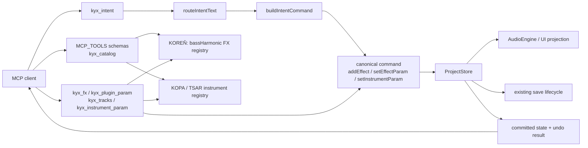

# KYX flagship plugin control audit

**Date:** 2026-10-21  
**Scope:** MCP and Intent control of KOPA, TSAR, and KOREŇ/GROW in KYX / Pulse Forge.  
**Method:** trace discovery, request routing, canonical commands, committed-state read-back, undo, and current tests before changing code. This is a focused supplement to the broader [MCP architecture audit](2026-10-20-mcp-control/ARCHITECTURE-AND-FINDINGS.md) and [capability matrix](2026-10-20-mcp-control/CAPABILITY-MATRIX.md).

## Architecture map

The server transports and live-store binding are shared infrastructure, covered in the broader audit. The focused path starts at [`src/mcp/tools.ts`](../../src/mcp/tools.ts): `MCP_TOOLS` defines discovery and schemas (lines 1440, 1713, 2061, 2088, and 2140); catalog and parameter handlers read the effect/instrument registries (lines 8818, 8976, and 9151); mutations use canonical commands and return committed-state read-back. Desktop binds that context to the renderer store in [`src/mcp/desktop-host.ts`](../../src/mcp/desktop-host.ts); web binds the owning browser session in [`src/mcp/web-host.ts`](../../src/mcp/web-host.ts). The headless host in [`src/mcp/headless-host.ts`](../../src/mcp/headless-host.ts) uses the same tool implementation for tests, but does not emulate audio.

Natural language enters through `kyx_intent` → `routeIntentText` ([`src/intent/route.ts`](../../src/intent/route.ts), lines 775 and 1083–1090) → `buildIntentCommand` ([`src/intent/command-for-route.ts`](../../src/intent/command-for-route.ts), lines 20–55). Effect intents use the existing `applyEffectIntent` command path ([`src/intent/mix.ts`](../../src/intent/mix.ts), lines 1075 onward). The parameter-aware Intent parser is effect-only today ([`src/intent/param-intent.ts`](../../src/intent/param-intent.ts) imports `EFFECT_META` and accepts `EffectType`); KOPA/TSAR parameter edits are available through exact MCP controls, not the free-text Intent parameter parser.

## Flagship capability matrix

| Plugin       | Product type                                 | Discover / metadata                                                                                                                                    | Instantiate                                                      | Exact parameter read/write                                                                                                     | Natural-language Intent                                                                                                            | Undo / read-back evidence                                                                                                                                                                                       | Assessment                                                                                                              |
| ------------ | -------------------------------------------- | ------------------------------------------------------------------------------------------------------------------------------------------------------ | ---------------------------------------------------------------- | ------------------------------------------------------------------------------------------------------------------------------ | ---------------------------------------------------------------------------------------------------------------------------------- | --------------------------------------------------------------------------------------------------------------------------------------------------------------------------------------------------------------- | ----------------------------------------------------------------------------------------------------------------------- |
| KOPA         | Instrument (`INSTRUMENT_DEFS.kopa`)          | `kyx_catalog subject:instruments` and `subject:instrument, instrument:kopa`                                                                            | `kyx_tracks addInstrument`; explicit `kyx_intent` track creation | `kyx_instrument_param` targets one track ID; registry clamp and enum/step checks                                               | Explicit track creation is covered; natural-language instrument-knob edits are not implemented by the effect-only parameter parser | `tests/mcp-instrument-control.test.ts` checks metadata, create, list, clamp, rejection, no-op, and undo                                                                                                         | **SUPPORTED** for exact parameter MCP control; **PARTIAL** for free-text knob control                                   |
| TSAR         | Instrument (`INSTRUMENT_DEFS.tsar`)          | `kyx_catalog subject:instruments` and `subject:instrument, instrument:tsar`                                                                            | `kyx_tracks addInstrument`; explicit `kyx_intent` track creation | `kyx_instrument_param` targets one track ID; registry clamp and enum/step checks                                               | Explicit track creation is covered; natural-language instrument-knob edits are not implemented by the effect-only parameter parser | `tests/mcp-instrument-control.test.ts` checks metadata, create, list, clamp, no-op, and undo                                                                                                                    | **SUPPORTED** for exact parameter MCP control; **PARTIAL** for free-text knob control                                   |
| KOREŇ / GROW | Effect (`bassHarmonic`, display name `GROW`) | `kyx_catalog subject:effects` and `subject:effect, effect:bassHarmonic`; metadata includes bounds, units, descriptions, steps, taper, and enum options | `kyx_fx` or an applicable effect Intent adds a missing instance  | `kyx_plugin_param` targets an exact track ID (or validated family) and 1-based instance; registry clamp and toggle/enum checks | `effectWordIn` recognizes “KOREŇ”/“koren”; primary-knob FX Intent now survives genre-context routing and includes value read-back  | `tests/koren-catalog.test.ts`, `tests/mcp-tools.test.ts`, and `tests/mcp-flagship-control.test.ts` cover discovery, exact insert/list/set, enum rejection, committed state, Intent routing, read-back, and undo | **SUPPORTED** for the tested exact MCP and primary-knob Intent paths; live audio audition remains **NOT VERIFIED** here |

## Verified finding and repair

[`src/intent/effect-words.ts`](../../src/intent/effect-words.ts) recognized `bassHarmonic` from `bass harmonic`, `koren`, and `harmonik`, but the genre-signal gate in [`src/intent/route.ts`](../../src/intent/route.ts) maintained a second explicit-effect-verb regex that omitted those aliases. Reproduction: `routeIntentText("Add KOREŇ to the bass in a drill beat", doc)` returned `pattern`, so `kyx_intent` would have treated the explicit plugin edit as generation. The guard now recognizes the normalized KOREŇ aliases with the explicit add/action-before-effect wording and the existing supported adjustment/effect-before-action wording.

The `kyx_intent` command path now also appends `effectReadback(before, after, intent)` for effect intents, exposing the committed parameter movement (for KOREŇ, `drive before→after on track`) after the command executes. The regression test verifies this through the headless host and undoes the resulting command.

## Verification

- `npx vitest run tests/mcp-flagship-control.test.ts tests/mcp-instrument-control.test.ts tests/koren-catalog.test.ts` — **3 files passed, 9 tests passed**.
- `npm run typecheck` — **passed** (`tsc --noEmit`, exit 0).
- `npx prettier --check src/intent/route.ts src/mcp/tools.ts tests/mcp-flagship-control.test.ts docs/audits/2026-10-21-flagship-plugin-control.md` — **passed**.
- `git diff --check` — **passed**.
- `node-gc -Root D:\pulse-forge` — **0 abandoned process trees**; two young/active test trees were ignored by policy.

## Scope boundary

This increment does not assess or alter plugin DSP quality. Headless MCP verification proves document mutation, validation, result reporting, and undo; it does not prove that the live audio graph audibly reflects a changed parameter. Full live audio audition remains a separate validation item in the broader audit. KOPA and TSAR remain **PARTIAL** for free-text parameter edits; exact MCP parameter writes and Intent-based track creation are verified.
